# SmartLoo — Requirement Analysis Report

**Version:** 0.4 — UI Spec Lite integrated review candidate, 16 October 2026
**Integration owner:** Özgür Kılıç (#12)
**Baseline:** [REQUIREMENTS.MD](REQUIREMENTS.MD), [data/security requirements](requirements/db-security.md), [Charter](CHARTER.MD)
**Existing review:** [PR #19](https://github.com/akcedia/SmartLoo/pull/19), `analysis_work → main`
**Delivery:** Friday update target; final PDF after approval, 18 October 23:59 (Europe/Istanbul).

## 1. Purpose and review status

This analysis explains the existing SmartLoo scope through domain, logical E-R, data-flow models and illustrative UI mockups. It adds no application feature implementation. The integrated draft addresses the [15 October TA review](https://github.com/akcedia/SmartLoo/pull/19#pullrequestreview-5537321012): behavioral models use DFD notation, UI mockups are included, and every model/mockup image is embedded in this report. Domain and E-R remain data models. Review approval and implementation verification are still pending.

The draft was prepared against PR #19 head `a0d0457218e494b2b5a7968ca8032b87ba9d143c`. Contributor files are integrated with corrections and attribution below; their remote PRs are not represented as merged. The original 14 October PR already exists; no new analysis PR is required.

| Contributor | Source and reviewed head | Integrated contribution |
|---|---|---|
| Özgür Kılıç | [#12](https://github.com/akcedia/SmartLoo/issues/12), PR #19 `a0d0457` | Domain/context, review and suggestion/moderation DFDs, closure, report integration and mockups |
| Fırat Karadoğan | [PR #20](https://github.com/akcedia/SmartLoo/pull/20) `9574159` | Logical E-R, dictionary, registration/login/authorization/deletion; corrected during integration |
| Emir Miraç İslamoğlu | [PR #22](https://github.com/akcedia/SmartLoo/pull/22) `cdd4e11` | Source mapping, AI summary/recommendation analysis; converted to DFD, evidence limitations made explicit |
| Onur Arda Buldağ | [PR #21](https://github.com/akcedia/SmartLoo/pull/21) `6a153a1` | Dashboard and import/export; access, provider ID and parameter wording reconciled |
| Ahmet Furkan Yardımcı | [#16 contribution](https://github.com/akcedia/SmartLoo/issues/16#issuecomment-6203237352) | Search/filter/map analysis; DFD and permission-denial contract reconciliation by Özgür |
| Yusuf Selim Aksu | [PR #18](https://github.com/akcedia/SmartLoo/pull/18) `2a2787a` | Traceability/consistency proposal; canonical FR/TC corrections by Özgür |

Owner review is pending for integration changes. PR #18 currently targets `main`; it must not bypass the analysis review merely because the other contributor PRs target `analysis_work`.

## 2. Data models and invariants

### 2.1 Domain model

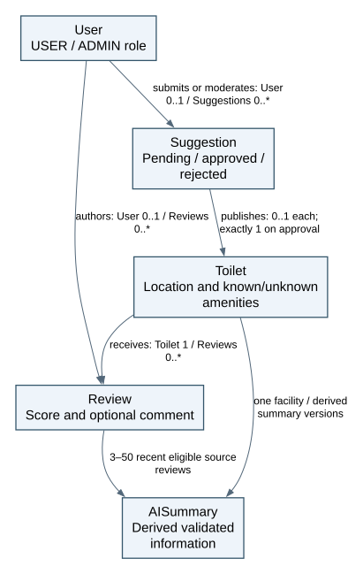

[Editable source and concept definitions](analysis/data/domain-and-er.md). User, Toilet, Review and Suggestion are core entities; AISummary is derived information, not a mandated permanent table. Guest is not a stored account; ADMIN is a User role. A summary draws on 3–50 recent eligible reviews. Anonymous retained reviews have no author account reference.

### 2.2 Logical E-R

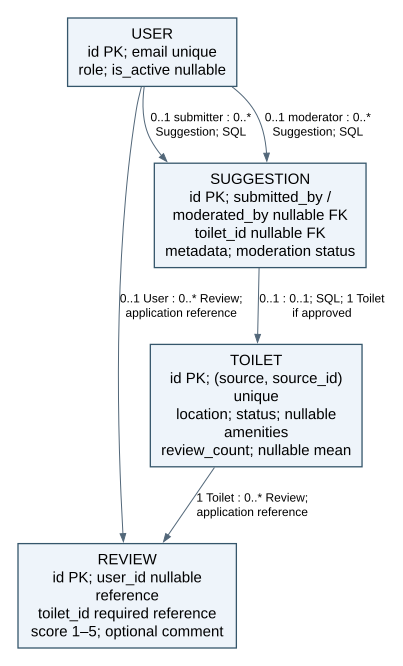

[Fırat's integrated E-R and complete data dictionary](analysis/data/er-data-dictionary.md) is the single logical E-R. Its labels show cardinalities and SQL versus application references. PostgreSQL holds accounts/facilities; MongoDB holds reviews; Redis caches summaries. SQL Suggestion storage, nullable submitter/moderator retention and published-facility linkage are proposed refinements. They are not implemented schema. Cross-store references are not SQL-enforced foreign keys.

One current review per non-null user/facility pair; integer score 1–5; optional comment ≤1000 characters. Unknown amenities, price and hours stay null. Mean is null and count zero without reviews. Keep baseline nullable `User.is_active`; its operational meaning is unresolved. Do not remove a baseline field merely because a test does not exercise it. Reviewed facilities close instead of being hard-deleted.

## 3. Behavioral models

**Notation:** rectangle = external entity, rounded rectangle = process, cylinder = data store. Arrows name data, not yes/no control branches. Process numbers identify functions. Shared stores: D1 Users, D2 Reviews, D3 Suggestions, D4 login-attempt counters, D5 Toilets/aggregates, D6 summary cache. Editable Mermaid source is beside each model in its source Markdown, following the syllabus format requirement. SVG layouts of the same relationships/data flows are prepared in one assets folder; the full attributes and constraints remain in the data dictionary.

### 3.1 System boundary

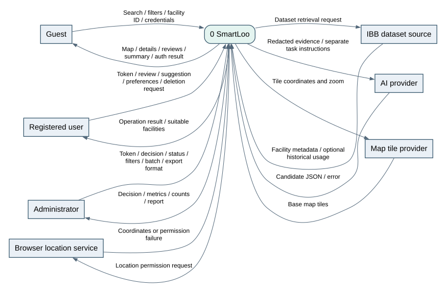

[Source](analysis/behavior/context.md). The boundary contains UI and backend. Location permission and base tiles are external services; tiles never supply facility records. IBB source access and AI generation are not dependencies for ordinary local facility search.

### 3.2 Location, filters and map — FR-01/02/09

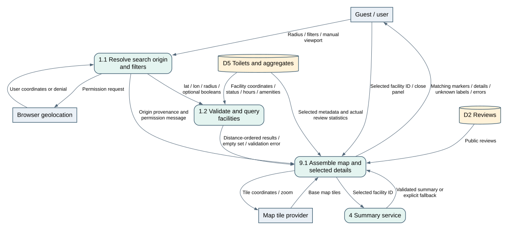

[Source and failure cases](analysis/behavior/map-search.md). Radius and coordinates are validated, optional amenities combine with AND, results sort by geographic distance. Permission denial keeps manual browsing available: the proposed UI uses its explicit viewport center as the existing nearby endpoint's origin, hides user-distance labels, and never treats that center as a user's location. This proposal needs owner review. Empty matches show an explanation. Unknown hours are excluded from open-only results. Map, details, public reviews and separately loaded AI summary remain consistent with selection.

### 3.3 Reviews — FR-03

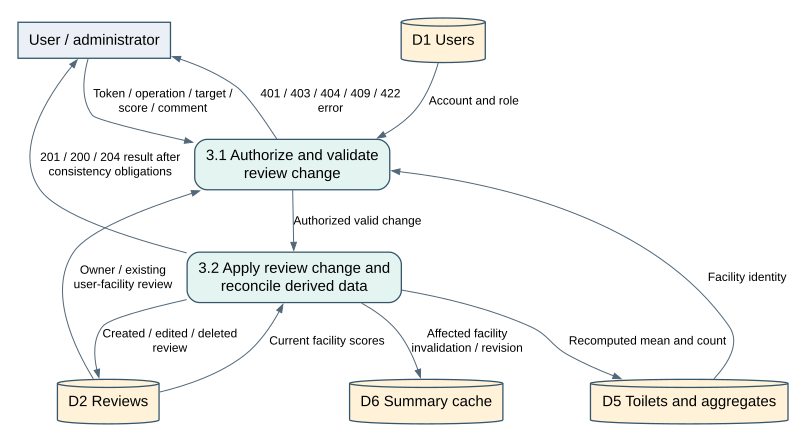

[Source and response rules](analysis/behavior/reviews.md). Only the owner edits; owner or ADMIN deletes. Duplicate creation is 409. Aggregates and cache reflect changes before completed success is acknowledged. Cross-store coordination and durable recovery remain design decisions, not a claim of a shared SQL transaction.

### 3.4 Suggestions, moderation and closure — FR-05/10

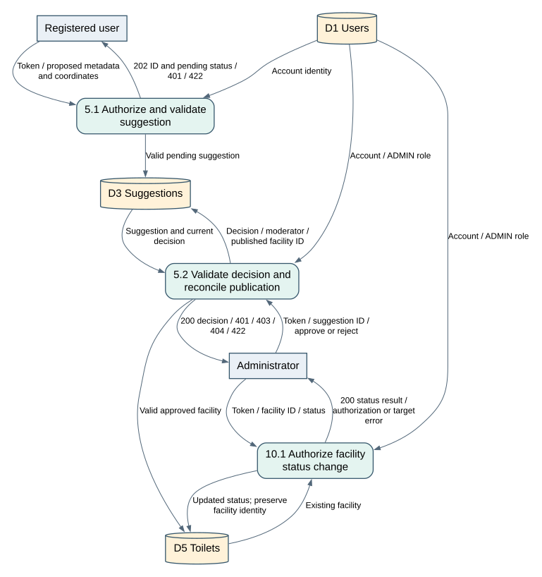

[Source](analysis/behavior/suggestions.md). Pending/rejected suggestions remain private. Approval reconciles facility publication and decision state; normal opening/filter rules still apply. Closure preserves reviewed facility identity. Duplicate locations and repeated decisions need a defined idempotency policy; no unsupported error codes are invented.

### 3.5 Authentication and personal-data deletion — FR-08/10

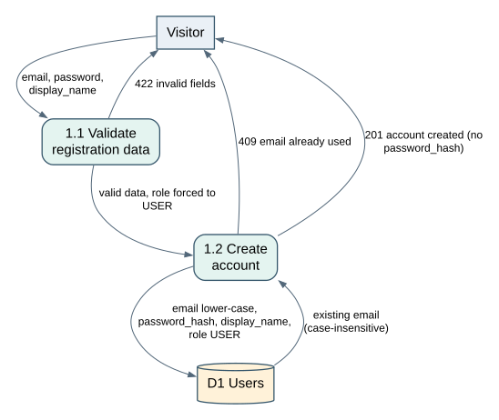

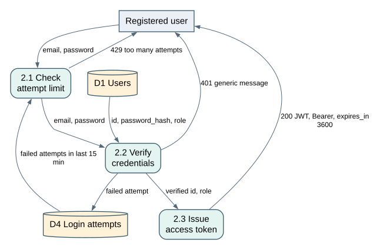

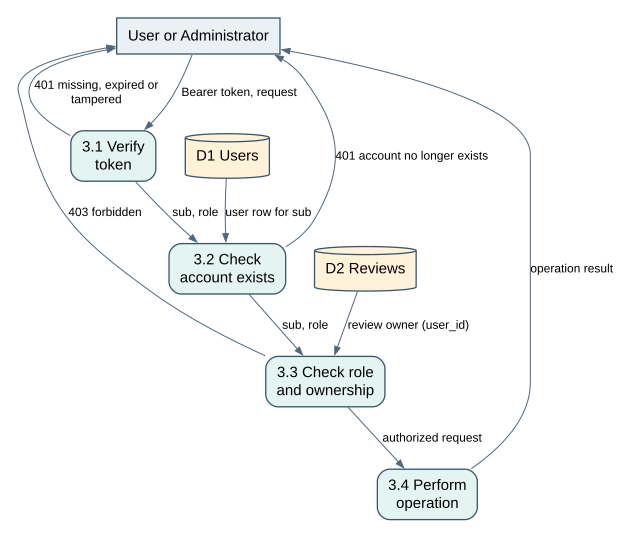

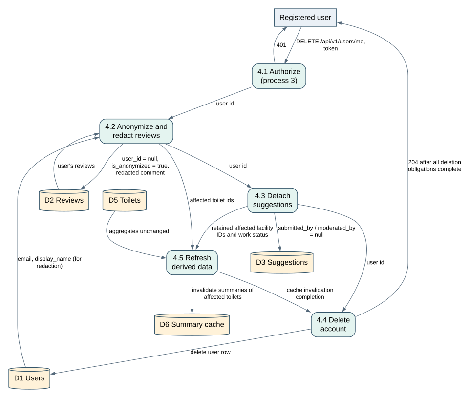

[Source, dictionary links and failure analysis](analysis/behavior/auth-account.md). Registration forces USER; password storage uses bcrypt/Argon2. Tokens last 60 minutes; invalid authentication is 401, forbidden access 403, input validation 422. Five failures in fifteen minutes trigger the specified login limit. Account deletion removes account personal data, anonymizes retained reviews, removes/redacts personal text and invalidates summaries. Preserve affected IDs before anonymization so recovery can still find unfinished work. A 204 response requires all obligations complete; automatic text-pattern redaction alone does not prove privacy compliance.

### 3.6 AI summaries and preference recommendations — FR-04

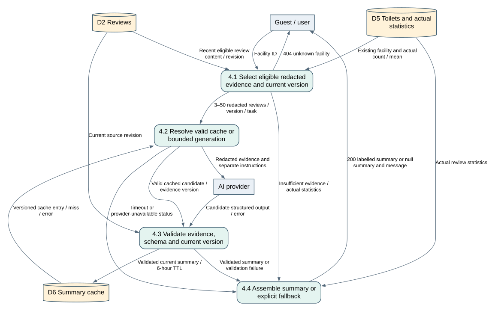

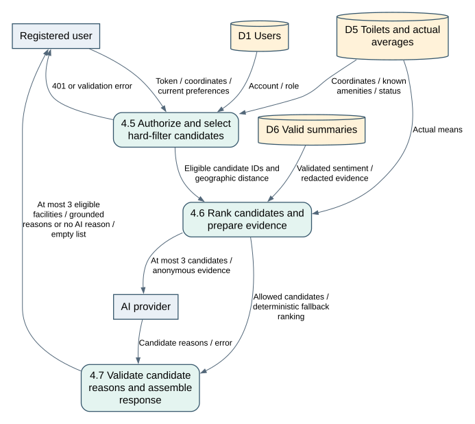

[Emir's detailed analysis and editable sources](analysis/SmartLoo_FR04_FR07_Analiz.md). Select at least 3 and at most 50 eligible reviews; redact PII and separate instructions from untrusted content. Validate structured Turkish output (summary ≤400 characters; pros/cons ≤3 each), evidence and current revision. Cache valid results for 6 hours; changes/redaction invalidate affected facilities. By 10 seconds, failure returns HTTP 200, null summary and actual statistics; insufficient evidence does not call the provider. Do not serve an invalidated summary. Recommendations first enforce hard preferences and return at most 3 eligible facilities; AI failure keeps suitable facilities without an invented reason. Ranking weights and exact semantic-validation methods remain design decisions.

### 3.7 Dashboard, import and export — FR-06/07

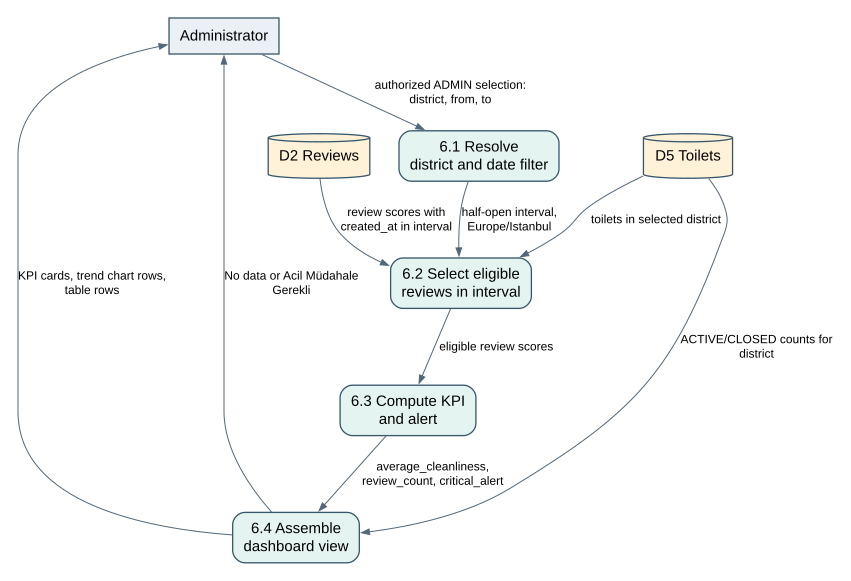

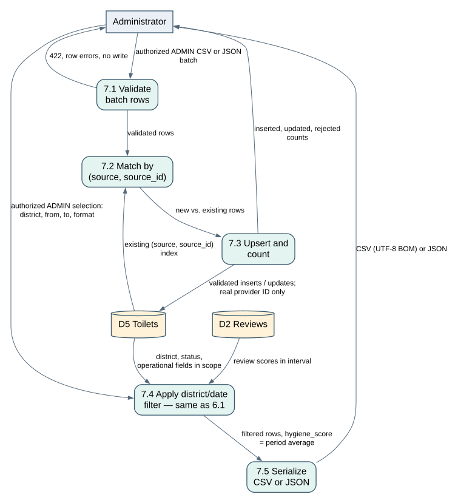

[Onur's detailed model](analysis/behavior/dashboard-import-export.md). All admin requests first use §3.5 authorization. District and inclusive Europe/Istanbul dates map to a half-open interval over review `created_at`. KPI is the mean of eligible individual scores; facility export rows contain their own period averages. No data means null, not zero; mean below 3.5 shows the specified alert. Active ratio is administrative status, not occupancy. API names are `district/from/to`.

CSV/JSON batches validate completely before live writes; any invalid row rejects the whole batch. Upsert uses `(source, source_id)`; provider ID is retained only when real. Export uses the same selection and five canonical columns: `facility_id,district,hygiene_score,open_issues_count,last_cleaned_at`. CSV uses UTF-8 BOM and quoting; missing operational data is blank/null, never AI-derived.

## 4. External data reconciliation

[Emir's contribution](analysis/SmartLoo_FR04_FR07_Analiz.md) reports detailed GeoJSON/XLSX profiling. Its raw evidence and profiling script are not in PR #22, so the new profile counts were not independently reproduced during integration. The report preserves his findings as attributed research, not verified execution by Özgür.

Known baseline source fields map longitude before latitude; missing amenities, prices and hours remain unknown. `BAKIM_ODASI` does not establish baby-changing availability without provider clarification. Administrative Aktif does not mean currently open. Historical passage counts are neither hygiene scores nor live occupancy. No trustworthy facility join is established, so optional historical usage stays separate.

Emir proposes a normalized district/name/coordinate fingerprint mapped to a SmartLoo UUID, with explicit collision handling and aliases for reviewed changes. This is a source-derived policy proposal, not an IBB facility ID. Production import must wait for ambiguous duplicates and seasonal status to be resolved. Synthetic `IBB-42` tests do not validate real-source identity.

## 5. UI specification and mockups

The instructor's newly supplied **UI Spec Lite (Educational Standard)** guide provides a Markdown screen-description format. [SmartLoo UI Spec Lite](analysis/ui-spec-lite.md) applies its Application section and all seven required screen headings (Purpose, Layout, Components, Actions, Navigation, User Flow and Notes) to eight screens: discovery map, facility details, sign in, register, review editor, facility suggestion, account privacy and administration.

The guide describes requirements → Markdown UI specification → AI-assisted mockup tool → visual refinement → implementation/export. Figma is an example tool. This submission provides the Markdown input and editable SVG mockups; it does not claim to have run a Figma conversion. The guide is treated as a course reference for structuring the work; the PR review remains the explicit request to include UI mockups.

These editable SVG wireframes are analysis artifacts, not working application screenshots. Values and facility names are illustrative. English/Turkish labels illustrate content; exact localization is a UI decision. The baseline's error-message contracts remain authoritative. Each plate groups related screens/states; it is not a proposal to display all states simultaneously.

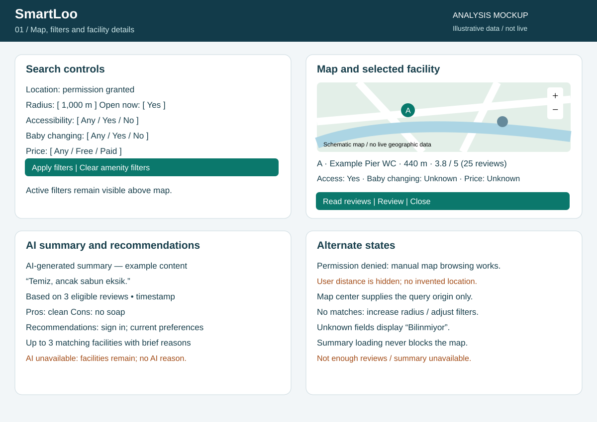

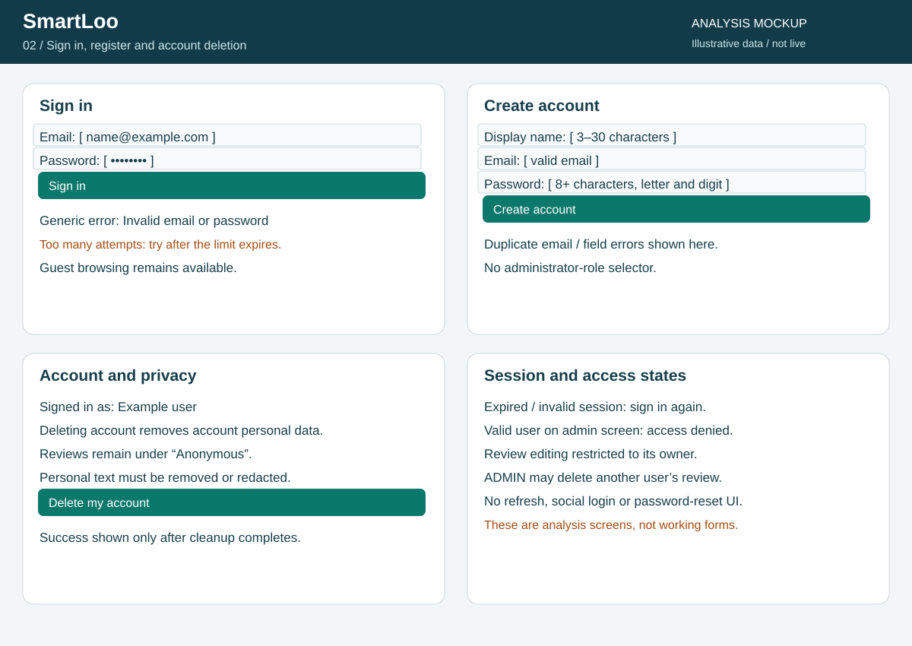

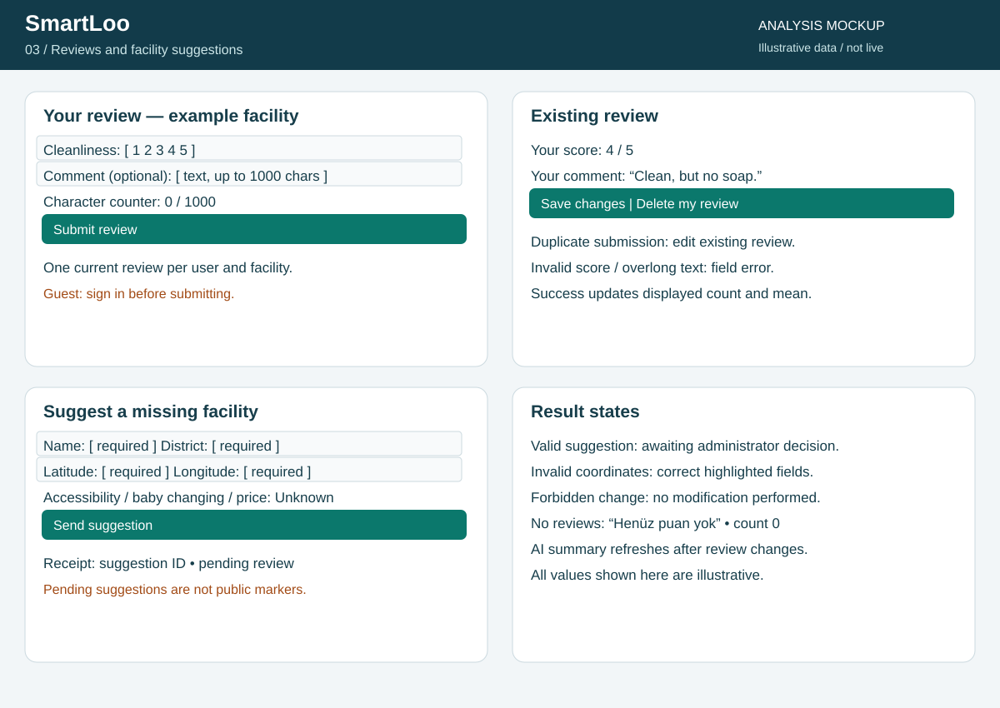

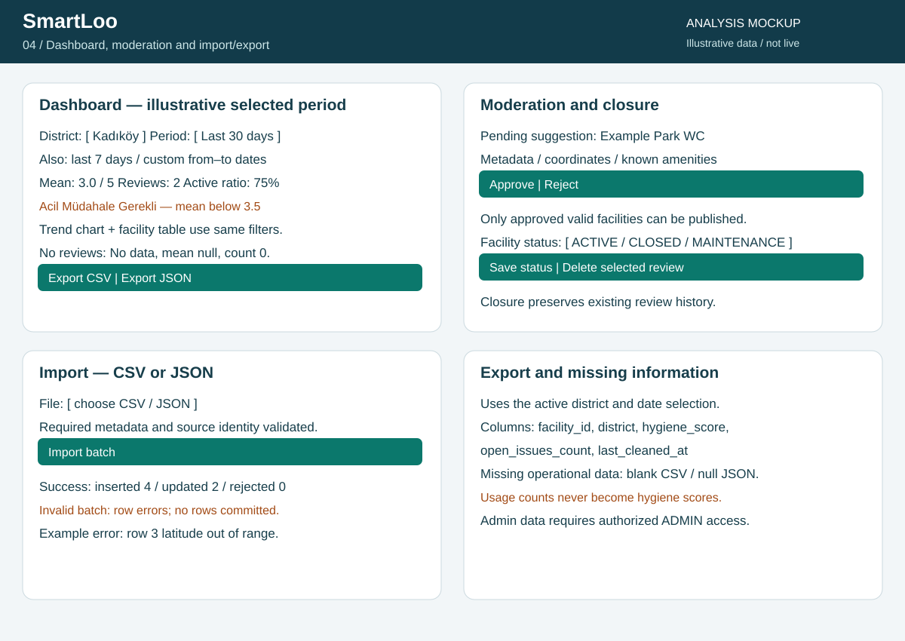

The map remains primary; unknown metadata is explicit, user distance is hidden without permission, and AI loading does not block discovery. Contribution screens show ownership, one-review behavior and pending suggestions. Admin screens use shared filters and expose atomic import errors. Mobile layout should stack these panels while retaining map controls; responsive behavior remains implementation/manual QA work.

## 6. Requirement/model/test traceability

The following assignments were derived from the existing 48-case catalog without renumbering. “Documented” means analysis coverage, not implementation success. [Yusuf's corrected matrix and QA limits](analysis/traceability_and_consistency.md) retains authorship and records integration corrections.

| FR | Capability | Primary model | Existing tests | Status |
|---|---|---|---|---|
| FR-01 | Nearby open facilities | [Model](analysis/behavior/map-search.md) | TC-01, TC-11, TC-14 | Documented; owner/TA review pending |
| FR-02 | Accessibility, baby-changing and price filters | [Model](analysis/behavior/map-search.md) | TC-02, TC-03, TC-12, TC-13 | Documented; owner/TA review pending |
| FR-03 | Create, edit and delete reviews | [Model](analysis/behavior/reviews.md) | TC-05, TC-06, TC-26, TC-31, TC-32, TC-35, TC-46 | Documented; owner/TA review pending |
| FR-04 | AI summaries and preference recommendations | [Model](analysis/SmartLoo_FR04_FR07_Analiz.md) | TC-08, TC-15, TC-16, TC-17, TC-28 | Documented; owner/TA review pending |
| FR-05 | Suggest and moderate facilities | [Model](analysis/behavior/suggestions.md) | TC-07, TC-18 | Documented; owner/TA review pending |
| FR-06 | District/date hygiene analytics | [Model](analysis/behavior/dashboard-import-export.md) | TC-09, TC-25 | Documented; owner/TA review pending |
| FR-07 | CSV/JSON import and report export | [Model](analysis/behavior/dashboard-import-export.md) | TC-10, TC-19, TC-20, TC-24, TC-36 | Documented; owner/TA review pending |
| FR-08 | Registration, login and roles | [Model](analysis/behavior/auth-account.md) | TC-04, TC-30, TC-37, TC-38, TC-39, TC-40, TC-41, TC-42, TC-43, TC-44, TC-45, TC-47, TC-48 | Documented; owner/TA review pending |
| FR-09 | Map and facility details | [Model](analysis/behavior/map-search.md) | TC-21, TC-22, TC-23 | Documented; owner/TA review pending |
| FR-10 | Integrity, account deletion and closure | [Model](analysis/behavior/auth-account.md) | TC-27, TC-29, TC-33, TC-34 | Documented; owner/TA review pending |

FR-10 also uses the E-R and closure model. TC-21 checks the initial HTML shell only; TC-22/23 and detailed marker behavior are manual procedures. NFR targets and verification procedures remain in REQUIREMENTS.MD §4. No application test run or passing feature claim accompanies this documentation revision.

## 7. Integration decisions and open work

| Topic | Decision / remaining boundary |
|---|---|
| UI Spec Lite guide | Added eight screen specifications with all seven standard headings; associated controls, navigation, user flows and failure states are traced to existing requirements and mockups. |
| TA model format | Behavioral models use DFD, and all diagram sources now use Mermaid as required by the syllabus. All model and mockup images are embedded here. |
| Canonical E-R | Fırat's model replaces provisional E-R. Domain and dictionary use the same entities. Nullable baseline is_active retained. |
| Canonical FR/TC | Yusuf's incorrect FR meanings/ranges corrected against all 48 catalog entries. |
| Source evidence | Missing PR #22 profile/evidence files are disclosed; local-machine links removed. Owner evidence is still required for reproduction. |
| Source identity and status | Fingerprint policy is a proposal. Physical duplicates, seasonal status and provider field meanings remain unresolved before production import. |
| Manual browsing | Existing nearby endpoint receives viewport center; UI does not claim user location/distance. Owner approval of this reconciliation is pending. |
| Cache and deletion | Per-facility version invalidation; retain affected IDs before anonymizing. Durable recovery/concurrency mechanism remains design work. |
| Suggestion lifecycle | SQL storage/retention and reserved source namespace are proposals. Duplicate and repeated decisions need a policy. |
| Analytics | Review created_at is the period field. Per-facility export averages and global KPI share the selected reviews, not an unweighted facility mean. |
| Optional operational data | Existing columns may use real records; no new cleaning-work-order system or fabricated values. |
| Other design choices | is_active semantics, exact recommendation weights, semantic AI validation and rejected-count definition remain open. |

## 8. Verification and delivery boundary

Local verification covers rendered SVGs, readable model/mockup layouts, Markdown links, consistent data-store names and catalog-based FR/TC coverage. It does not establish working application flows. Source files and generated images must travel together; no diagram is provided solely as an external link or raw source block.

Update the existing `analysis_work` branch and PR #19 only after Özgür approves the concrete diff. Keep contributor attribution; no new analysis PR, automatic issue closure, reviewer notification or main merge is implied. Instructor approval, final PDF rendering from this Markdown with all images checked, and Learn upload remain separate delivery steps. The PDF is not generated or submitted by this revision.
