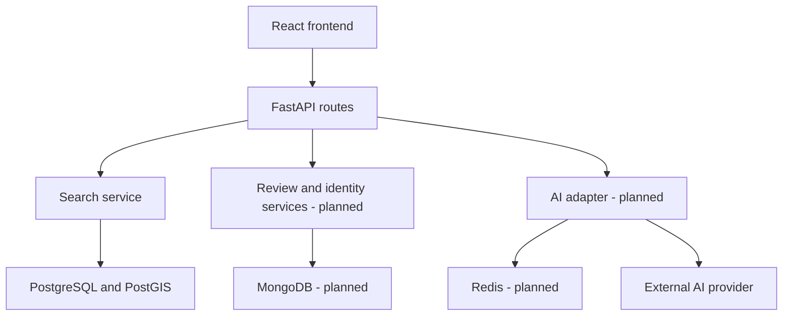

# SmartLoo — Tasarım Belgeleri

Bu dosya tasarım katkılarının giriş noktasıdır. Ortak mimari ve sözleşme kararları ekip incelemesiyle kesinleşir.

- [Dış veri adapter’ı ve AI servis sözleşmesi](design/adapter-ai-contract.md) — #28; inceleme için tasarım önerisi. Veri dönüşümü, kaynak kimliği, AI girdi/çıktısı, fallback, cache ve mock senaryolarını kapsar.

Dayanaklar: [gereksinimler](REQUIREMENTS.MD), [analiz](ANALYSIS.MD) ve [ortak yapı görevi #23](https://github.com/akcedia/SmartLoo/issues/23).

Bu belgelerin bulunması, ilgili özelliklerin uygulanmış veya testlerinin geçmiş olduğu anlamına gelmez.
## 24 October integration decisions (Özgür, #23)

The review branch preserves contributor modules: `src/` backend, `frontend/` shared React host, `db/` migrations and `tests/` acceptance tests. Onur's host becomes the common frontend starting point; Furkan will add the discovery screen. No second frontend scaffold is needed.

This diagram is the target architecture, not an implementation status claim. The current API routes return 501. Public facility search will use the local SQL store and must not require live IBB or AI access. Root Compose uses PostGIS 16-3.4 and SMARTLOO_DB_* variables to match Fırat's contribution. MongoDB/Redis remain planned and are not required for the current SQL checks.

### Search contract and implementation boundary
GET `/api/v1/toilets/nearby` accepts lat [-90,90], lon [-180,180], radius [1,50000] metres (default 1000), open_now and optional has_disabled_access/has_baby_changing/is_free booleans. Return `{count,results}` with UUID id, name, latitude, longitude and distance_m plus available metadata. Sort ascending by distance, then UUID for ties. Invalid parameters are 422; no matches is 200 with an empty list. Omitted amenities impose no constraint; unknown values match neither true nor false filters.

Use the SQL `nearby_toilets()` interface from db/migrations/002_nearby_toilets.sql for the production adapter. A Python adapter and route integration are still required under #25. Retain create_app's test-injection seam, with fixture and production adapters separated. Do not implement a route by reading expected test outputs.

With denied geolocation, use an explicit map viewport centre as the search origin and hide user-distance claims. open-only excludes unknown hours. The SQL parser currently supports 24/7 and a single time range; a richer schedule format requires a subsequent reviewed decision. Source administrative status is not evidence of opening hours.

### Admin contract review disposition
Q1: accept today plus previous 29 days in Europe/Istanbul. Q2: retain current no-limit proposal for now; define a tested resource limit before production. Q3: accept unknown district as 200/no data. Q4: retain the static district list for the labelled demo; a source-backed list is future work. Q5: retain one response for the demo; pagination/volume limits require production design. Q6: total includes all district facilities, active counts ACTIVE only, independent of review date selection. Q7: preserve API precision and display two decimals. These are integration recommendations pending team review, not claims of implemented backend contracts.

Review finding: the no-data example in admin-analytics-api.md omits the per-day null trend and zero-review facilities described above it. Resolve that distinction before implementing the analytics backend. Review/cache recovery, account deletion and repeated moderation remain open architectural decisions.

## Verification and next integration
See [weekly review](WEEKLY-2026-10-24.md). Next critical path: #23 review, #25 Python/PostGIS adapter, #26 map connection, then #27 end-to-end validation. The 25 October demo is an internal target, not an instructor deadline. Formal design/test/code deadlines remain 15/22/30 November per the supplied syllabus.
