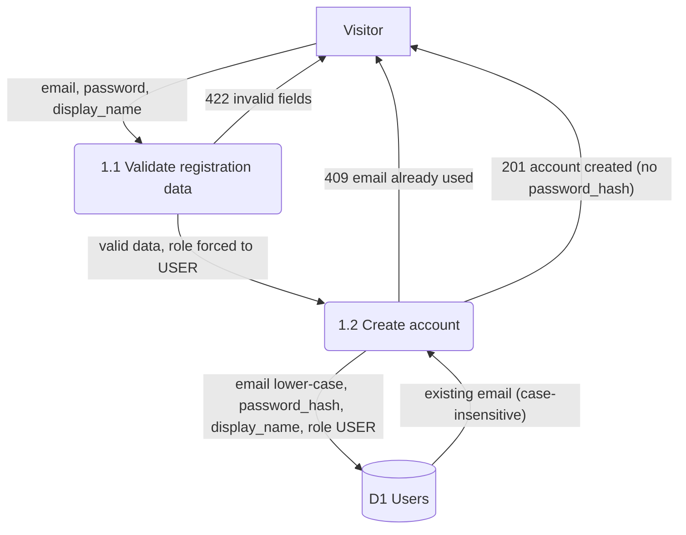
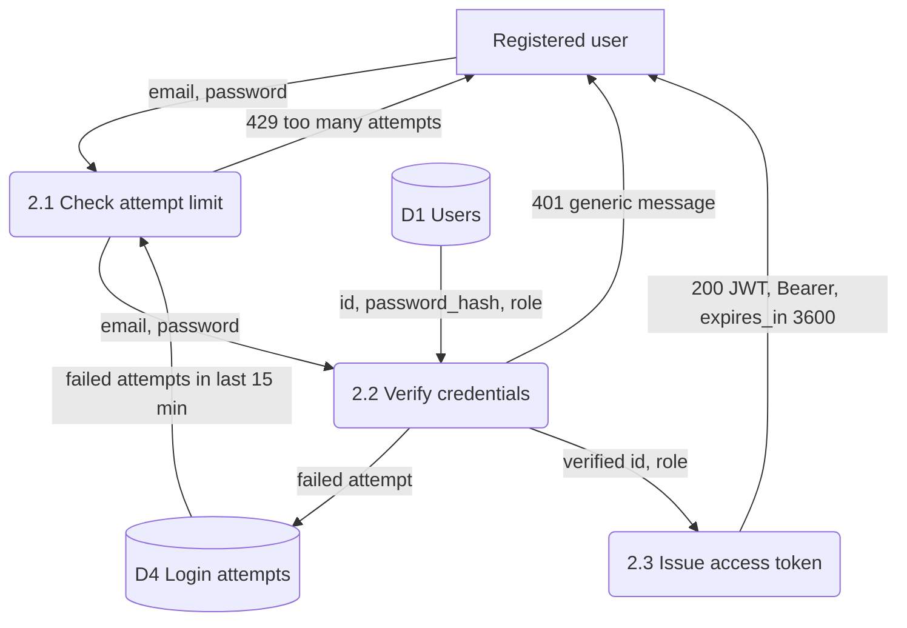
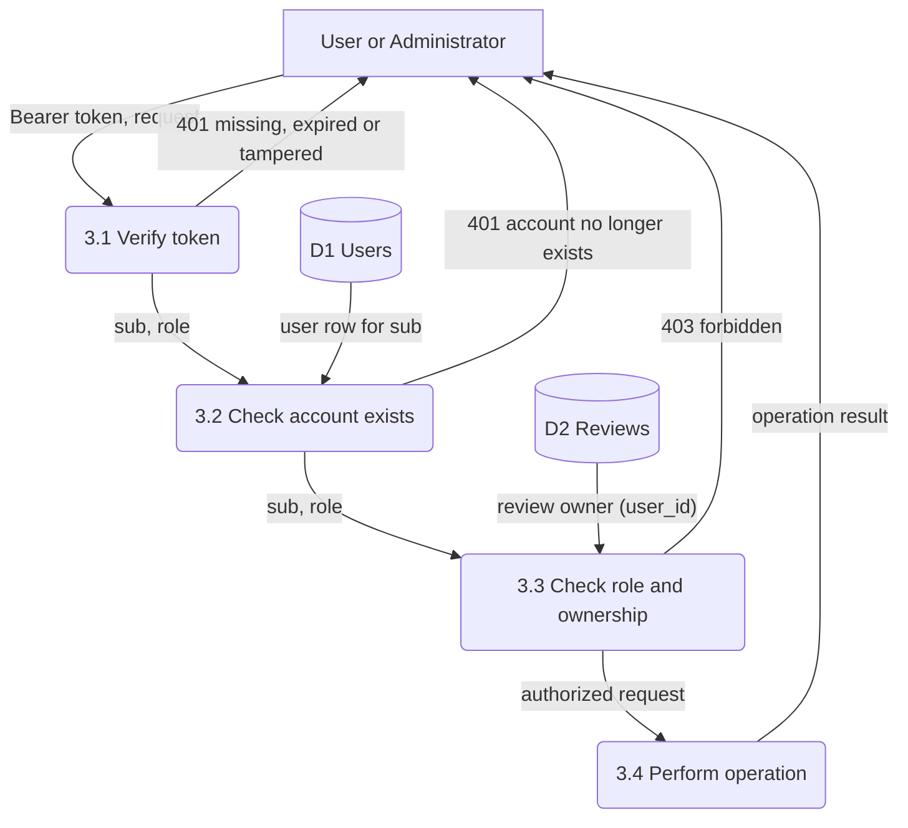
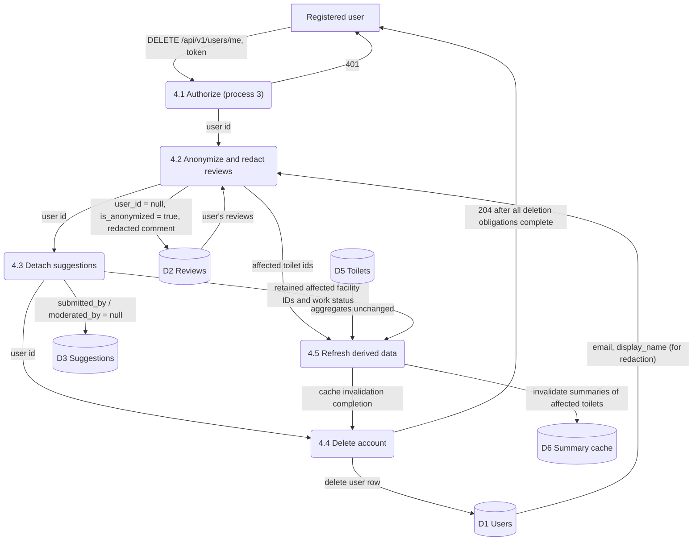

# Authentication, authorization and account deletion (DFD)

Owner: Fırat Karadoğan (Issue #13). Version 0.2, 15 October 2026. Covers FR-08 and the account-deletion part of FR-10. Baseline: [REQUIREMENTS.MD §3.8, §3.10](../../REQUIREMENTS.MD) and [db-security.md](../../requirements/db-security.md). Entities and fields follow [er-data-dictionary.md](../data/er-data-dictionary.md).

**Notation.** Rectangles are external entities, rounded boxes are numbered processes, cylinders are data stores (D1–D6). Arrow labels name the data that flows. Error flows are labelled with their HTTP result.

| Store | Contents | Technology |
|---|---|---|
| D1 Users | User rows | PostgreSQL |
| D2 Reviews | Review documents | MongoDB |
| D3 Suggestions | Suggestion rows | PostgreSQL |
| D4 Login attempts | Failed-login counter per email, 15-minute expiry | Redis (proposal) |
| D5 Toilets | Toilet rows and aggregates | PostgreSQL |
| D6 Summary cache | Cached AI summaries per toilet | Redis |

## 1. Registration (REQ-SEC-01, TC-30, TC-37, TC-38, TC-48)

Editable Mermaid source

- 1.1 checks: valid email; password ≥ 8 characters with at least one letter and one digit; display name 3–30 characters. Any `role` field sent by the client is ignored, so public registration can never create an ADMIN.
- 1.2 hashes the password with bcrypt (cost ≥ 10) or Argon2. The plaintext password is neither stored nor logged.

## 2. Login (REQ-SEC-02, REQ-SEC-07, TC-39, TC-40, TC-47)

Editable Mermaid source

- 2.1: after 5 failed attempts for the same email within 15 minutes, further attempts return 429 until the window expires.
- 2.2: an unknown email and a wrong password give the **same** 401 message, so attackers cannot find out which emails are registered.
- 2.3: the JWT is signed with a server-side secret from an environment variable and contains `sub` (user id), `role`, `iat` and `exp` (60 minutes). There is no refresh token in this baseline.

## 3. Authorization of a protected request (REQ-SEC-03–05, TC-41–TC-46)

Editable Mermaid source

- 3.1 rejects a missing header, a malformed token, a token signed with another key and an expired token, each with 401.
- 3.2 is needed because JWTs are not stored server-side: after account deletion, a still-unexpired token must stop working. If the `sub` user no longer exists, the request gets 401.
- 3.3: `/api/v1/admin/**` requires role `ADMIN` (USER gets 403). A review can be edited or deleted only when `review.user_id = sub`; an ADMIN may delete any review. Read-only endpoints (search, details, reading reviews) skip this whole process.

## 4. Account deletion (FR-10, REQ-DB-04, TC-34)

Editable Mermaid source

### 4.1 What happens to each piece of data

| Data | On account deletion | Why |
|---|---|---|
| User row: `email`, `display_name`, `password_hash`, `role` | **Deleted** (D1) | Personal account data; TC-34 expects the user record to be removed |
| Review `cleanliness_score`, `tags`, `toilet_id`, timestamps | **Kept** | Toilet averages and review counts stay correct (D-R8) |
| Review `user_id` | **Set to `null`**, `is_anonymized = true`; shown as "Anonymous" | No link back to the person. Done explicitly in MongoDB, because no cross-store foreign key does it automatically |
| Review `comment` | **Redacted** (see 4.2) | Nulling `user_id` alone is insufficient (FR-10) |
| Suggestion `submitted_by`, `moderated_by` | **Set to `null`** (SQL `ON DELETE SET NULL`) | Facility data stays; pending suggestions can still be decided by another admin |
| Toilet `average_cleanliness`, `review_count` | **Unchanged** | Scores are kept, so no recalculation is needed |
| Cached AI summaries of affected toilets | **Invalidated** (D6) | A cached summary may quote the old comment text |
| Existing JWT | Stops working at once | Process 3.2 finds no user for `sub` and returns 401 |

### 4.2 Personal data inside review comments

Process 4.2 replaces the following with `[removed]` in each of the user's comments, before the user row is deleted (the user's own email and display name are still readable then):

1. the user's own email address and display name;
2. any other email address or phone number pattern.

Automatic redaction cannot recognise every personal detail in free text (for example, a home address written in words). Such remaining cases are handled by the existing administrator moderation: an ADMIN may delete any review (REQ-SEC-05). Redaction retains the score. If moderation deletes a review instead, aggregates and cache must be updated by the review model. Automatic pattern removal alone is not a complete personal-data-removal guarantee; handling residual PII remains a design and verification obligation.

### 4.3 Order and failure behaviour

Deletion must not return 204 until account removal, review anonymization/redaction, suggestion detachment and affected-cache invalidation are complete. Capture the affected review/facility IDs and required personal-data redaction context durably before clearing user references. A retry cannot rediscover already anonymized reviews with `user_id`, so repeating the original query alone is insufficient. Concurrent review creation and summary regeneration must not reintroduce the deleted user's data. The coordination, retry journal, token rejection and recovery mechanism remain design decisions; no cross-store transaction or automatic retry safety is claimed. Do not acknowledge completed deletion on partial failure. Retained review scores do not change; separate ADMIN deletion of a review does change aggregates.

Account deletion does not conflict with review integrity: every retained review still references an existing toilet, keeps its valid score, and no longer references any user.

## 5. Requirement and test mapping

| Process | Requirement | Tests |
|---|---|---|
| 1 Registration | FR-08, REQ-SEC-01, REQ-SEC-06 | TC-30, TC-37, TC-38, TC-48 |
| 2 Login | FR-08, REQ-SEC-02, REQ-SEC-07 | TC-39, TC-40, TC-47 |
| 3 Authorization | FR-08, REQ-SEC-03–05 | TC-41–TC-46 |
| 4 Account deletion | FR-10, REQ-DB-04, NFR-08 | TC-34, NFR-T07 |

Open items: whether the AI summary cache can be invalidated per toilet (D-2 in the data model), and whether a confirmation step (re-entering the password) is required before deletion. The latter is not in the current requirements and is proposed for team decision.
