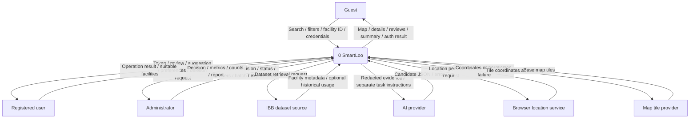

# SmartLoo system context (DFD)

Owner: Özgür Kılıç — issue #12.

Integration draft, 16 October 2026; pending owner/TA review. Baseline: [requirements](../../REQUIREMENTS.MD).

Editable Mermaid source

The boundary includes browser UI and backend. Guest, user and administrator are roles, not separate databases. Internal stores are hidden at context level. Rectangles are external entities, rounded rectangles are processes and cylinders in detailed DFDs are stores. Arrows carry named data; they do not prescribe call order.

IBB supplies downloadable metadata, not live occupancy or hygiene. Historical usage is optional and is not joined to facilities without a verified crosswalk. Map tiles do not supply SmartLoo facility records. Browser coordinates are distinct from a manually selected map center. Read-only search uses local data independently of AI availability. No secrets or account identifiers enter AI review payloads.

Detailed DFDs refine these boundary flows; their process numbers identify functions, not execution sequence.
