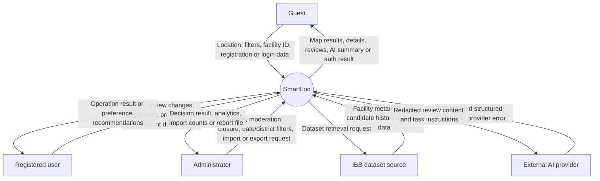

# SmartLoo system context (DFD)

Owner: Özgür Kılıç. Initial model, 14 October 2026. Covers the boundary for FR-01–FR-10; detailed models must refine these flows without adding unsupported features.

The source is a downloadable external dataset, not an assumed live sensor feed. Historical usage data is optional until joins are validated; it is not hygiene feedback. The provider never receives server secrets through review text or direct browser credentials. Map-tile and browser-location services support the map view; their detailed boundary flows are pending Furkan's model. Guest, registered user and administrator are permission roles and may be the same person in different contexts. Internal stores are intentionally hidden at the context level.
