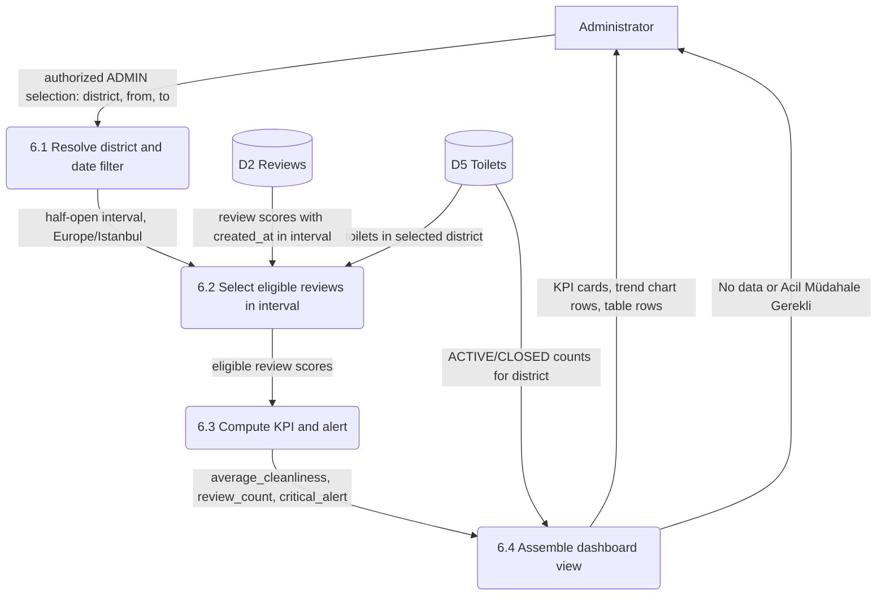
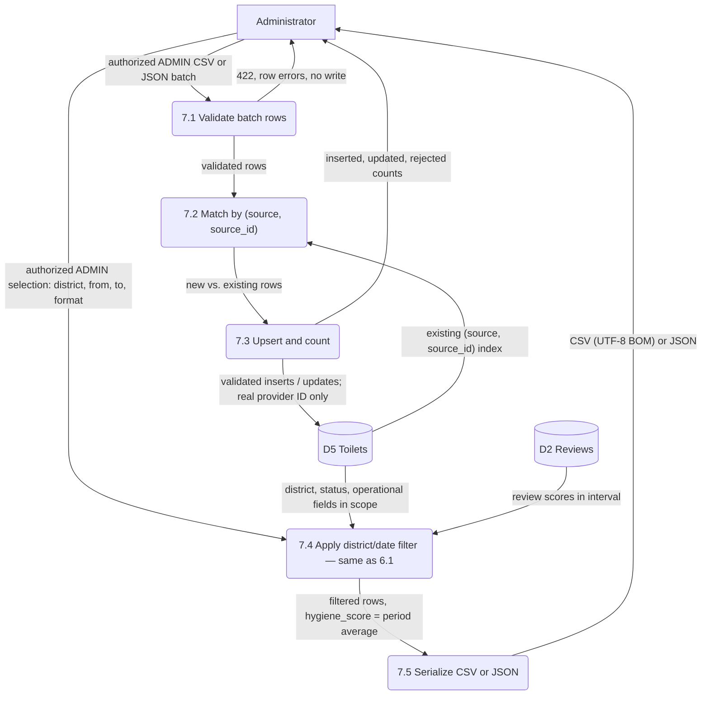

# Dashboard, import and export data-flow model

Owner: Onur Arda Buldağ (Issue #15). Version 0.1, 16 October 2026. Covers FR-06 and FR-07. Baseline: [REQUIREMENTS.MD §3.6, §3.7](../../REQUIREMENTS.MD). Entities and fields follow [er-data-dictionary.md](../data/er-data-dictionary.md) and [domain-and-er.md](../data/domain-and-er.md).

**Notation.** Rectangles are external entities, rounded boxes are numbered processes, cylinders are data stores. Store numbering follows [auth-account.md](auth-account.md): D2 and D5 below are the same stores, not new ones.

| Store | Contents | Technology |
|---|---|---|
| D2 Reviews | Review documents (`toilet_id`, `cleanliness_score`, `created_at`) | MongoDB |
| D5 Toilets | Toilet rows and aggregates (`district`, `status`, `average_cleanliness`, operational fields) | PostgreSQL |

## 1. District/date hygiene dashboard (FR-06, TC-09, TC-25)

Editable Mermaid source

- **Inputs:** `district` (optional — omitted means all districts), `from`, `to`. Default period is the last 30 calendar days; last 7 days and a custom interval are also available. Dates are inclusive in Europe/Istanbul, implemented as a half-open timestamp interval ending at the following midnight.
- **Date field resolved (closes open item D-5 from `er-data-dictionary.md`):** the filter applies to `Review.created_at`, not any `Toilet` timestamp. The dashboard measures when hygiene feedback was submitted, matching how TC-09's fixture reviews are selected by creation time.
- **Average rule:** `average_cleanliness` is the arithmetic mean of eligible review scores inside the selected interval — **not** an unweighted mean of per-facility averages. District and date filters apply identically to the KPI, the trend chart and the table (TC-09).
- **Empty result:** no matching reviews ⇒ `review_count = 0` and average is `null`, shown as **"No data"**. Never substitute zero (TC-25).
- **Critical alert:** average strictly below 3.5 shows a red alert with the text **"Acil Müdahale Gerekli"**. This threshold is the team's proposed choice, owned by Onur (REQUIREMENTS.MD §3.6).
- **Active facility ratio:** computed from the administrative `status` field (`ACTIVE` vs total) for the selected district, not real-time occupancy. If status data is unavailable, display **"Unknown"**.
- **Outputs:** `review_count`, `average_cleanliness` (or null), `critical_alert` (boolean), active-facility ratio (or "Unknown"), and the table/chart rows behind them.

## 2. Import and export (FR-07, TC-10, TC-19, TC-20, TC-24, TC-36)

Editable Mermaid source

### 2.1 Import rules

- **Validation:** every row needs `name`, `district`, valid coordinates and the supplied metadata fields. Invalid latitude/longitude (e.g. lat 95) fails validation.
- **Atomicity:** if any row in the batch is invalid, the **entire batch** is rejected with `422` and per-row errors; no row is written, valid or not (TC-20).
- **Identity / upsert:** matching on `(source, source_id)` updates the existing record instead of inserting a duplicate; İBB-origin records retain `ibb_source_id` only when the provider actually supplies a stable ID; otherwise it stays null. Importing the same source record twice must not create a duplicate — the response distinguishes inserted vs. updated counts (TC-19, TC-36).
- **Open dependency:** the exact derivation of `source_id` for the verified İBB GeoJSON (which has no explicit stable ID) is still pending Emir's (#14) and Fırat's (#13) decision (tracked as open item D-1 in `er-data-dictionary.md`). Emir now supplies a fingerprint/UUID policy proposal, with unresolved production collisions. This model consumes whatever `(source, source_id)` identity they finalize — it does not redefine it, so the import flow above stays valid once D-1 is resolved.
- **Result:** the administrator receives inserted / updated / rejected counts per import.

### 2.2 Export rules

- **Filter reuse:** export reuses the **same** district/date filter resolution as the dashboard (process 6.1 / 7.4 above), so dashboard and export always describe the same selection — this is the issue's consistency requirement.
- **CSV:** UTF-8 with BOM, `text/csv; charset=utf-8`, RFC 4180-style quoting, with a download filename.
- **JSON:** same row meaning, `application/json`.
- **Columns (both formats):** `facility_id, district, hygiene_score, open_issues_count, last_cleaned_at`.
- **`hygiene_score`:** the selected-period facility review average — a per-facility mean from the same eligible reviews as the dashboard KPI; the district KPI remains a review-weighted mean, not a mean of facility means, not an all-time average.
- **Missing operational data:** `open_issues_count` and `last_cleaned_at` come from imported/administrative records, never inferred from AI review text. When absent, they are **blank** in CSV and **null** in JSON — never fabricated.

## 3. Requirement and test mapping

| Process | Requirement | Tests |
|---|---|---|
| 6 Dashboard (filter, aggregate, KPI, alert) | FR-06 | TC-09, TC-25 |
| 7.1–7.3 Import (validate, match, upsert) | FR-07 | TC-19, TC-20, TC-36 |
| 7.4–7.5 Export (filter, serialize) | FR-07 | TC-10, TC-24 |

## 4. Open items for team review

| ID | Question | With |
|---|---|---|
| D-5 | Resolved above: dashboard/export date filter uses `Review.created_at`. | — |
| D-6 | Final `source_id` derivation for the İBB dataset (no stable provider ID in the verified GeoJSON) — this model's import/export columns are stable regardless of the answer, but the upsert key is not yet final. | Emir, Fırat |
| D-7 | Are `open_issues_count` and `last_cleaned_at` populated only through CSV/JSON import, or does a later operational feature write them directly? Out of scope for this baseline either way. | Özgür |

This is a requirements-analysis model: it does not claim a working dashboard, an implemented import pipeline, or a transaction mechanism across PostgreSQL/MongoDB. Those remain implementation and design work (REQUIREMENTS.MD §8).

## 5. Shared access and failure contract

All incoming admin requests first pass the authorization DFD in auth-account.md: invalid/missing token 401, valid USER 403; neither may read admin metrics or write a batch. Date/query validation failure returns the canonical validation error; the exact additional date-range constraints remain design work. API parameter names are `district`, `from`, `to`, and `format` for export. The diagrams show data after authorization, not a public dashboard. On atomic rejection applied insert/update counts are zero. The meaning of `rejected` (invalid rows versus all uncommitted rows) remains open. Review dates use `created_at`. No date range with zero reviews produces a fabricated zero rating.
