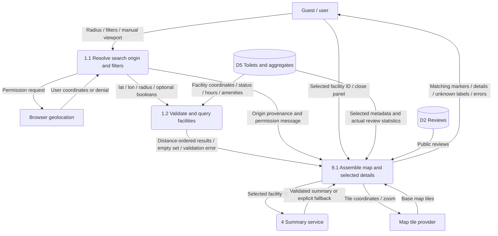

# Location, filtering and map (DFD)

Original analysis: Ahmet Furkan Yardımcı — [issue #16](https://github.com/akcedia/SmartLoo/issues/16#issuecomment-6203237352). DFD conversion and contract reconciliation: Özgür Kılıç.

Integration draft, 16 October 2026; pending owner/TA review. Baseline: [requirements](../../REQUIREMENTS.MD).

Editable Mermaid source

FR-01, FR-02 and FR-09. The issue's unresolved citation placeholders have been replaced by the canonical requirements reference above. Its checked boxes are acceptance expectations, not executed tests.

`GET /api/v1/toilets/nearby` requires lat (−90..90), lon (−180..180); radius 1..50000 m, default 1000. Optional boolean amenities combine with AND. Omit a filter for no constraint; do not send the string `null`. Unknown values match neither true nor false. Clearing amenity filters keeps the current radius/open-status selection. Geographic distance is not walking distance.

**Permission denial integration proposal:** keep the map usable. Use the visible map center as the explicit query origin for the existing nearby endpoint, with current radius/filters. This is a browsing center, never a claimed user location. The API's `distance_m` still measures from its supplied origin; the UI hides user-distance labels and retains `userLocation=null`. No request is made with missing lat/lon and no new endpoint is introduced. Pan/zoom refreshes queries consistently with the visible search area. Initial center selection is a UI configuration decision. This reconciles manual browsing with the required endpoint coordinates; owner review is pending.

`open_now=true` excludes known closed facilities and unknown opening hours; hours use Europe/Istanbul. General browsing may explicitly request `open_now=false` and show status/unknown information. Active administrative status alone never proves open-now. Empty results return 200 with `count=0, results=[]`; invalid parameters return 422. UI offers filter/radius adjustment without inventing facilities.

Marker selection loads `/toilets/{id}`, public `/toilets/{id}/reviews` and separate `/toilets/{id}/summary`. AI delay does not block map rendering. Selected details show unknown metadata explicitly; selecting another marker replaces the panel. Tile data and facility data remain separate.

Tests: TC-01–03, TC-11–14, TC-21–23. TC-21 automates only HTML hooks; TC-22/23 and marker interaction remain manual, not run.
