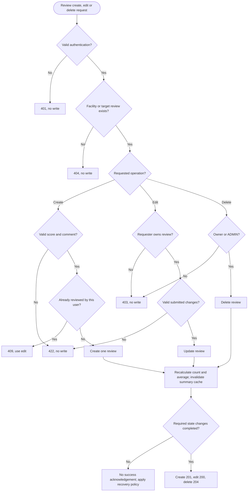

# Review lifecycle business process

Owner: Özgür Kılıç. Initial model, 14 October 2026. FR-03, with FR-08 authentication, FR-10 integrity and FR-04 cache implications.

Inputs: JWT, target ID, operation, score/comment where applicable. Stores: users/facilities, reviews and summary cache. Outputs: documented status/result and updated observable aggregates. Authentication failure is 401; authenticated but forbidden access is 403. Missing targets are 404. Validation and uniqueness errors do not mutate state. When all reviews are removed, the average becomes null and count zero.

The model states a consistency obligation, not an implemented transaction across SQL/MongoDB/Redis. Failure compensation, recovery and error response details remain design decisions. User ownership permits editing; ADMIN deletion is permitted by the canonical API contract. An ADMIN role alone does not grant editing someone else's review.

Related tests: TC-05, TC-06, TC-26, TC-31–TC-35, TC-41–TC-43, TC-46. AI cache invalidation: TC-16. All are specified acceptance tests, not evidence that feature implementation passes.
