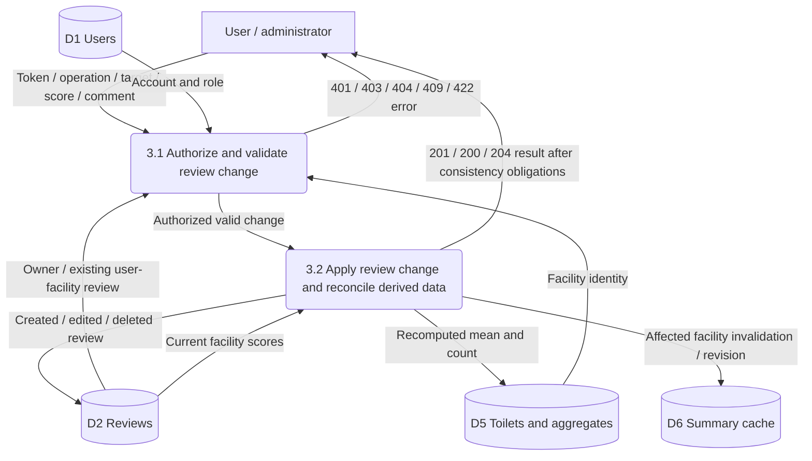

# Review management (DFD)

Owner: Özgür Kılıç — issue #12.

Integration draft, 16 October 2026; pending owner/TA review. Baseline: [requirements](../../REQUIREMENTS.MD).

Editable Mermaid source

FR-03, with FR-08 authorization, FR-10 integrity and FR-04 cache effects.

- Create takes the user ID from the verified token. One current review per non-null `(user_id, toilet_id)`; duplicate creation returns 409. Anonymous retained reviews do not collide under that rule.
- Owner may edit/delete; ADMIN may delete any review, but role alone does not permit editing another user's review.
- Score is an integer 1–5; optional comment is at most 1000 characters. Invalid input returns 422, missing target 404, invalid authentication 401 and forbidden operation 403. These failures make no review changes.
- Public reading is provided by the map/detail model; this diagram refines mutation requests only.
- Recompute the actual mean and count and invalidate the affected summary before acknowledging success or serving stale summaries. With no reviews, mean is null and count is zero.
- Cross-store atomicity is not assumed. Recovery must retain affected facility IDs and operation identity; retries must not create duplicate reviews or lose invalidation work. The durable coordination mechanism remains a design decision. Failed coordination must not be reported as completed success.

Tests: TC-05, TC-06, TC-26, TC-31, TC-32, TC-35, TC-46; related TC-16, TC-33 and TC-41–43. These specify behavior; no implementation pass is claimed.
