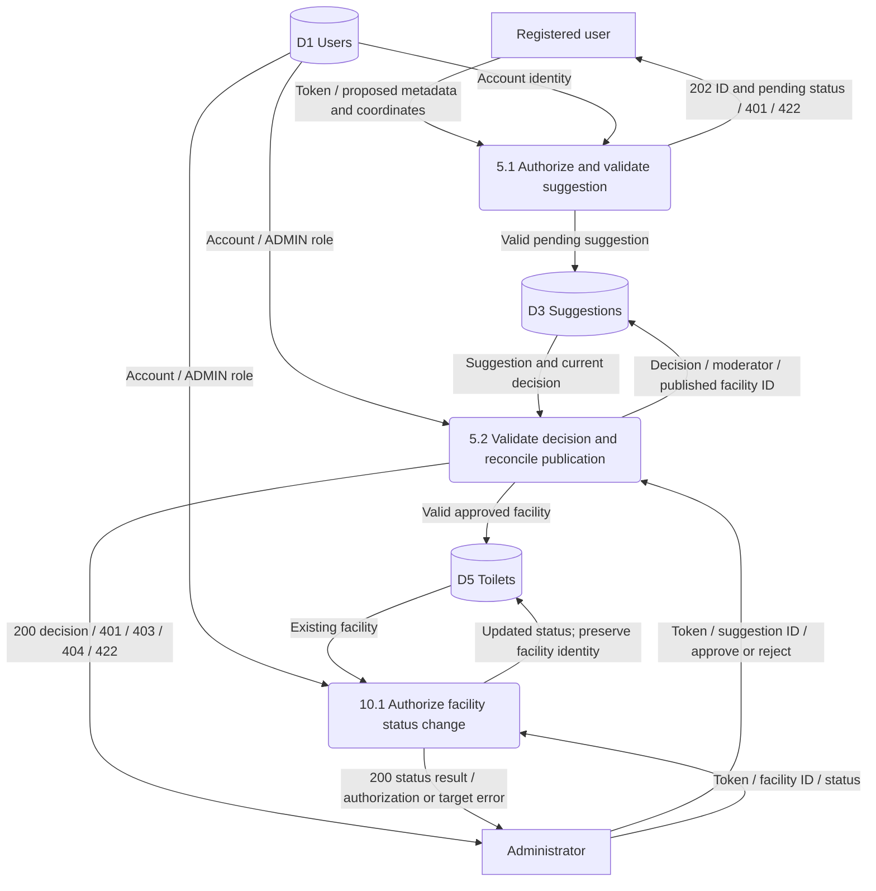

# Suggestion, moderation and facility closure (DFD)

Owner: Özgür Kılıç — issue #12.

Integration draft, 16 October 2026; pending owner/TA review. Baseline: [requirements](../../REQUIREMENTS.MD).

Editable Mermaid source

FR-05 and the facility-closure part of FR-10; protected by FR-08.

Pending/rejected suggestions are never queried as public facilities. Approval publishes a valid facility and the linked decision consistently, returning success only after both obligations are met. Approval does not prove current opening: normal radius, amenity, administrative status and opening-hour checks still apply. Reviewed facilities are marked CLOSED, not hard-deleted; existing reviews remain attached.

Fırat's proposed SQL Suggestion stores nullable submitter/moderator and published toilet ID. `source='suggestion'`, `source_id=suggestion.id` is a proposed reserved namespace; imported batches must not impersonate it. Storage and namespace enforcement remain design choices. An approved suggestion publishes one facility; pending/rejected ones publish none.

Repeated decisions, duplicate physical locations and concurrent approvals remain explicit design decisions. No new conflict status code or automatic merge policy is specified here. A retry must not publish a second facility; the final idempotency/recovery mechanism needs design review. Personal-data deletion detaches account references and removes/redacts retained personal text.

Tests: TC-07, TC-18, TC-27; authorization follows REQ-SEC-03/04.
