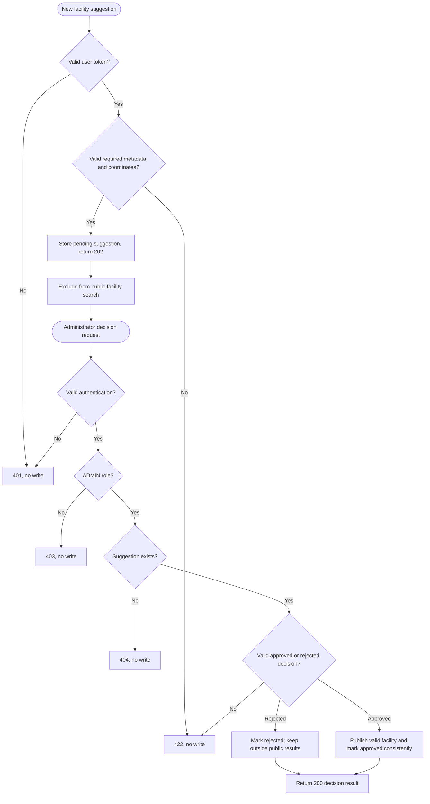

# Suggestion and moderation business process

Owner: Özgür Kılıç. Initial model, 14 October 2026. FR-05, FR-08 and FR-10.

Only an approved suggestion creates an eligible public facility; normal open/radius/filter rules still apply. Approval does not prove that the toilet is currently open. Suggested coordinates and metadata must remain valid. Successful moderation must not expose an approved status without its corresponding facility being published consistently.

Repeated decisions, duplicate suggested locations and the exact rejection/conflict policy are not fully specified in the baseline. They must be agreed during team review; do not invent response codes or claim those scenarios are tested. Related tests: TC-07 and TC-18, with FR-08 role rules.
