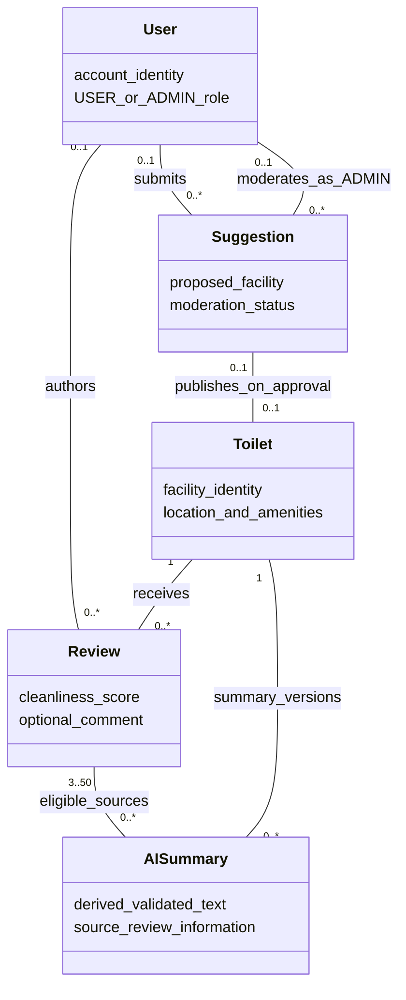

# Domain model and logical E-R reference

Owner: Özgür Kılıç (Issue #12). Integration revision, 16 October 2026.

**Status: integrated analysis draft for owner/TA review.** Özgür owns the domain model; Fırat owns the logical E-R. Storage proposals do not change the requirements baseline.

## 1. Domain concepts

| Concept | Meaning | Requirements |
|---|---|---|
| User | Registered account with USER or ADMIN permission role | FR-03, FR-05, FR-08, FR-10 |
| Toilet | Public facility with location and known/unknown amenities | FR-01, FR-02, FR-09, FR-10 |
| Review | One user's hygiene score and optional comment for one facility | FR-03 |
| Suggestion | Proposed facility awaiting administrator decision | FR-05 |
| AISummary | Derived, validated summary of a facility's reviews, optionally cached | FR-04 |

Guest is an external role, not a stored account. Administrator is a role of User, not a separate person/entity. A summary is derived information and not assumed to be a new permanent database table. Analytics are derived from facility/review data; no extra analytics table is introduced here.

Editable Mermaid source

The review author may be absent after account deletion. Each summary uses 3–50 selected recent eligible reviews under FR-04; historical source versions and cache representation are later design decisions. A facility can have summary versions over time, but this model does not prescribe storing all versions. Suggestion author/moderator cardinalities reflect the integration proposal: existing requirements do not fully define suggestion retention when an account is deleted. Pending suggestions have no moderation decision. Moderator records, if retained, must not prevent personal-data deletion.

## 2. Canonical logical E-R

The integrated [Fırat E-R and data dictionary](er-data-dictionary.md) replaces the provisional E-R. There is one logical E-R in this submission.

## 3. Constraints and storage interpretation

- Review creation requires an existing account and facility. After account deletion, `Review.user_id` is nullable and public author is Anonymous. Remove/redact personal information in retained free text too.
- At most one current review per `(user_id, toilet_id)` for non-null user IDs. Rating is an integer 1–5; optional comment is at most 1000 characters.
- USER/ADMIN is a server-controlled permission role. Public registration cannot grant ADMIN.
- Latitude is within −90..90 and longitude within −180..180. Unknown amenities, pricing and opening hours remain null/unknown and are displayed explicitly. Unknown does not match an explicit true/false filter.
- `average_cleanliness` is null when there are no reviews; `review_count` starts at zero. Recalculate both before acknowledging a successful review change.
- Reviewed facilities are closed rather than hard-deleted. Approved suggestions publish a valid facility; rejected/pending suggestions remain outside public nearby results.
- Import identity is `(source, source_id)`; retain a provider `ibb_source_id` only when actually available. Emir's source-derived fingerprint/UUID proposal is documented in the source analysis; production collision handling awaits owner agreement.
- PostgreSQL holds accounts/facility metadata, MongoDB holds reviews, and Redis may cache summaries, following the Charter and requirements. The E-R is a **logical relationship model**: FK-labelled cross-store references are not database-enforced SQL foreign keys in MongoDB. Cross-store coordination is a software design decision.
- Suggestion storage location, retained moderator identifiers and suggestion deletion policy are unresolved proposals, not implemented schema.

This is a requirements-analysis model. Physical indexes, migrations, service classes and deployment topology are not delivered here.
