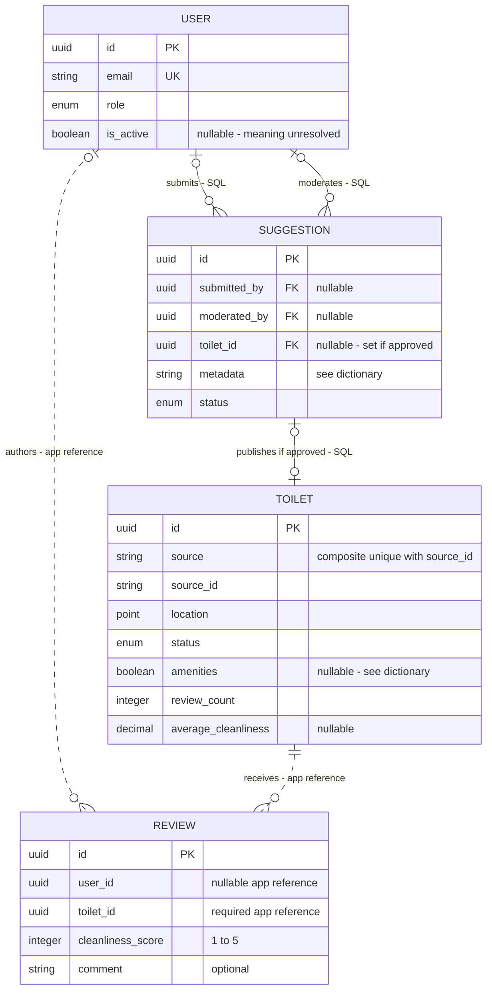

# E-R model, data dictionary and storage mapping

Owner: Fırat Karadoğan (Issue #13). Version 0.2, 15 October 2026.

**Status: owner contribution for team review.** Replaces the provisional E-R in [domain-and-er.md](domain-and-er.md) for User, Toilet, Review and Suggestion. Baseline: [requirements](../../REQUIREMENTS.MD) (FR-03, FR-05, FR-08, FR-10) and [data/security rules](../../requirements/db-security.md) (REQ-DB-01–06, REQ-SEC-01–07). No entity beyond these four is introduced; AISummary remains a derived concept owned by the AI flow (#14).

## 1. Logical E-R model

Editable Mermaid source

**Notation.** Edge labels give cardinalities and enforcement. SQL relationships are proposed foreign keys; MongoDB references are application-enforced. The data dictionary below supplies full attributes, nullability and constraints. This is a logical model, not an implemented schema.

### 1.1 Keys and cardinalities

| Relationship | Cardinality | Meaning | How it is kept |
|---|---|---|---|
| User – Review | 0..1 : 0..* | A user can write many reviews. A review has one author, or none after the author's account is deleted | `review.user_id` holds a `USER.id` value; the application verifies it at write time |
| Toilet – Review | 1 : 0..* | A toilet can have many reviews. Every review belongs to exactly one existing toilet | `review.toilet_id` holds a `TOILET.id` value; non-existent toilet returns 404 (TC-33) |
| (User, Toilet) – Review | at most 1 | At most one review per user–toilet pair. A second submission returns 409 (TC-32); the user edits the existing review instead | Unique on `(toilet_id, user_id)` for non-null `user_id` (proposal: MongoDB partial unique index) |
| User – Suggestion (submits) | 0..1 : 0..* | A user can submit many suggestions. Submitter becomes empty after account deletion | SQL FK `submitted_by`, `ON DELETE SET NULL` |
| User – Suggestion (moderates) | 0..1 : 0..* | An ADMIN decides suggestions. Empty while pending or after the admin's account is deleted | SQL FK `moderated_by`, `ON DELETE SET NULL` |
| Suggestion – Toilet | 0..1 : 0..1 | An approved suggestion publishes exactly one toilet; pending/rejected ones publish none | SQL FK `toilet_id`, set on approval |

**Identifiers.** All primary keys are system-generated UUIDs. Small numbers or names in BDD examples are fixture aliases. Toilets additionally have the import identity `(source, source_id)`, unique (REQ-DB-06). A toilet published from a suggestion uses `source = "suggestion"` and `source_id = suggestion.id`, as a proposed reserved namespace. Imports must reject impersonation of that namespace; collision prevention is a design obligation, not automatic.

**Why anonymous reviews do not break uniqueness.** The uniqueness rule applies only to reviews with a non-null `user_id`. Several anonymous reviews (`user_id = null`) can therefore exist for the same toilet without violating "one review per user–toilet pair".

## 2. Data dictionary

Columns follow Issue #13: meaning, type, required, nullable, basic validation. "Required" means the client must supply it or the system must set it on creation.

### 2.1 User — PostgreSQL (REQ-DB-02)

| Field | Meaning | Type | Required | Nullable | Basic validation |
|---|---|---|---|---|---|
| `id` | Account identity, JWT `sub` claim | UUID | System | No | Primary key |
| `email` | Login identifier | string (max 254) | Yes | No | Valid format; unique case-insensitive (stored lower-case); duplicate → 409 (TC-30) |
| `password_hash` | One-way password hash | string | System | No | bcrypt cost ≥10 or Argon2; never returned by the API (TC-38) |
| `display_name` | Name shown on the user's reviews | string (3–30) | Yes | No | Length 3–30 |
| `is_active` | Baseline account flag; semantics unresolved | boolean | No | Yes | Do not infer an account-suspension policy |
| `role` | Permission role | enum `USER`, `ADMIN` | System | No | Public registration always sets `USER` (TC-48) |
| `created_at` | Registration time | timestamp | System | No | Set by the system |

`is_active` remains nullable as required by REQ-DB-02. Its operational meaning is unresolved; this analysis does not remove it or invent an account-suspension feature.

### 2.2 Toilet — PostgreSQL/PostGIS (REQ-DB-01)

| Field | Meaning | Type | Required | Nullable | Basic validation |
|---|---|---|---|---|---|
| `id` | Facility identity | UUID | System | No | Primary key |
| `source`, `source_id` | Import identity | string | Yes | No | Unique together; repeated import updates, never duplicates (TC-36) |
| `ibb_source_id` | Stable İBB identifier, if the provider supplies one | string | No | Yes | Unique when present |
| `name` | Facility name | string (max 150) | Yes | No | Non-empty |
| `latitude`, `longitude` | Location (WGS84); stored as PostGIS `geography(Point, 4326)` for search | decimal | Yes | No | lat −90..90, lon −180..180; otherwise 422 (TC-29) |
| `district` | İstanbul district | string | Yes | No | Non-empty |
| `address` | Street address | string | No | Yes | — |
| `has_disabled_access` | Wheelchair accessible | boolean | No | **Yes** | `null` = unknown, **not** `false`; unknown does not match a true or false filter |
| `has_baby_changing` | Baby-changing room | boolean | No | Yes | Same three-valued rule |
| `is_free` | Free of charge | boolean | No | Yes | Same three-valued rule |
| `price_try` | Price in TRY when paid | decimal | No | Yes | ≥ 0 |
| `opening_hours` | Opening hours text | string | No | Yes | Unknown hours are excluded from open-only results |
| `status` | Administrative status | enum `ACTIVE`, `CLOSED`, `MAINTENANCE` | System | No | Default `ACTIVE`; reviewed toilets become `CLOSED`, never hard-deleted |
| `average_cleanliness` | Mean of the toilet's review scores | decimal (1–5) | Derived | Yes | `null` when no reviews; recalculated before a review change is acknowledged (REQ-DB-05) |
| `review_count` | Number of reviews | integer | Derived | No | ≥ 0, default 0 |
| `created_at`, `updated_at` | Timestamps | timestamp | System | No | — |

### 2.3 Review — MongoDB `reviews` collection (REQ-DB-03)

| Field | Meaning | Type | Required | Nullable | Basic validation |
|---|---|---|---|---|---|
| `id` | Review identity | UUID (string) | System | No | Primary key |
| `toilet_id` | Reviewed facility | UUID (string) | Yes | No | Must match an existing `TOILET.id`; otherwise 404 |
| `user_id` | Author | UUID (string) | System (from token) | Yes | Must match the authenticated user at creation; becomes `null` on account deletion |
| `cleanliness_score` | Hygiene score | integer | Yes | No | 1–5; otherwise 422 (TC-31) |
| `comment` | Free-text feedback | string (max 1000) | No | Yes | ≤ 1000 characters; rendered as text, never HTML |
| `tags` | Predefined labels such as `well-lit`, `no-soap` | array of string | No | Yes | Values from the predefined list |
| `is_anonymized` | Set when the author's account was deleted | boolean | System | No | Default `false` |
| `created_at`, `updated_at` | Timestamps | timestamp | System | No | — |

Publicly, a review with `user_id = null` is attributed to "Anonymous". The author's display name is never copied into the review document; it is looked up from PostgreSQL when shown, so deleting the user removes it everywhere at once.

### 2.4 Suggestion — PostgreSQL (FR-05)

| Field | Meaning | Type | Required | Nullable | Basic validation |
|---|---|---|---|---|---|
| `id` | Suggestion identity | UUID | System | No | Primary key; returned with 202 on submission |
| `submitted_by` | Submitting user | UUID, FK → User | System (from token) | Yes | `null` after the submitter's account is deleted |
| `moderated_by` | Deciding administrator | UUID, FK → User | System | Yes | `null` while pending; must have role `ADMIN` when set |
| `toilet_id` | Toilet published on approval | UUID, FK → Toilet | System | Yes | Set only when `status = APPROVED` |
| `name`, `district` | Proposed facility name and district | string | Yes | No | Same rules as Toilet |
| `latitude`, `longitude` | Proposed location | decimal | Yes | No | Valid ranges; otherwise 422 |
| `has_disabled_access`, `has_baby_changing`, `is_free` | Proposed amenities | boolean | No | Yes | `null` = unknown |
| `status` | Moderation state | enum `PENDING`, `APPROVED`, `REJECTED` | System | No | Starts `PENDING`; pending/rejected never appear in public results |
| `created_at`, `decided_at` | Timestamps | timestamp | System | Yes (`decided_at`) | `decided_at` set together with `moderated_by` |

## 3. Storage mapping and cross-store identity

| Data | Proposed store | Reason |
|---|---|---|
| User, Toilet, Suggestion | PostgreSQL (PostGIS for location) | Relational integrity, SQL foreign keys, spatial queries (Charter) |
| Review | MongoDB `reviews` | As specified in FR-03 |
| `average_cleanliness`, `review_count` | PostgreSQL, on Toilet | Denormalized for fast filtering and sorting (FR-03) |
| AI summary cache | Redis (TTL 6 h) | FR-04; owned by #14 |
| Failed-login counters | Redis (key per email, TTL 15 min) | Proposal for REQ-SEC-07; not an E-R entity |

**Identity between stores.** PostgreSQL generates every User and Toilet UUID. A review document stores the same UUID values as strings in `user_id` and `toilet_id`. These are **application-level references, not foreign keys**: MongoDB does not reject a review that points to a missing toilet, and PostgreSQL does not update reviews when a user row is deleted. The application therefore:

1. checks that the toilet exists before inserting a review (404 otherwise); the baseline does not define a separate prohibition on reviewing an existing CLOSED facility;
2. takes `user_id` from the verified JWT, never from the request body;
3. on account deletion, explicitly updates the user's review documents (there is no `ON DELETE SET NULL` across stores; see [auth-account.md](../behavior/auth-account.md));
4. recalculates the Toilet aggregates in PostgreSQL before acknowledging a review change.

How the two writes in step 4 and in account deletion are made consistent (ordering, retries, outbox, etc.) is a design-phase decision, as allowed by Issue #13.

## 4. Data rules summary

| ID | Rule | Source | Tests |
|---|---|---|---|
| D-R1 | One review per user–toilet pair; second submission 409, count unchanged | REQ-DB-03 | TC-32 |
| D-R2 | Score integer 1–5, comment ≤ 1000 characters | FR-03 | TC-31 |
| D-R3 | Review must reference an existing toilet (404) and the authenticated user | REQ-DB-04 | TC-33 |
| D-R4 | Unknown amenity or price values stay `null`; they are shown as unknown and never treated as `false` | REQ-DB-01, FR-02 | TC-02, TC-03 (filters) |
| D-R5 | Aggregates recalculated before success is acknowledged; `null` average when no reviews | REQ-DB-05 | TC-35 |
| D-R6 | Toilets with reviews are closed, not hard-deleted | REQ-DB-04 | TC-27 |
| D-R7 | Import upserts by `(source, source_id)`, never duplicates | REQ-DB-06 | TC-36 |
| D-R8 | Account deletion keeps review scores, so toilet aggregates do not change | REQ-DB-04 | TC-34 |

## 5. Open items for team review

| ID | Question | With |
|---|---|---|
| D-1 | The İBB GeoJSON has no stable ID. Which fields form the source-derived `source_id`? | Emir, Onur |
| D-2 | Is the AI summary cache keyed only by `toilet_id`, so that account deletion can invalidate it per toilet? | Emir, Özgür |
| D-3 | Should an approved suggestion that duplicates an existing toilet be merged or rejected? | Özgür |
| D-4 | Is `is_active` (REQ-DB-02) needed? Retained as nullable; operational semantics remain open | Özgür, Yusuf |
| D-5 | Are the date filters of the dashboard based on review `created_at`? | Onur |

This is a requirements-analysis model. Physical schema, indexes, migrations and the detailed consistency mechanism are left to design.

## 6. Integration reconciliation, 16 October

D-1: Emir supplies a source-derived fingerprint/UUID policy proposal; production identity collisions still need owner approval. No provider ID is fabricated. D-2: versioned per-facility cache invalidation is specified by the AI analysis; concurrency mechanism remains design work. D-3 duplicate/repeated moderation remains open. D-4 baseline `is_active` retained. D-5 resolved to review `created_at` by Onur. SQL Suggestion storage, retention, `is_anonymized`, namespace and index choices are analysis proposals, not new mandatory requirements.
