# SmartLoo — Software Design Report

**Course:** CMPE 331 · **Revision:** 0.2 for review · **Date:** 11 November 2026  
**Team contact:** Özgür Kılıç

## 1. Design baseline

The [project Charter](../CHARTER.MD) defines the technology stack and milestones. The [approved requirements](../REQUIREMENTS.MD) and [analysis](../ANALYSIS.MD) define this release's scope. The release uses responsive web screens and preference-based facility recommendations. Native mobile delivery and turn-by-turn navigation are outside this release baseline. FR-08 specifies a signed, 60-minute JWT. The [UI Spec Lite](../analysis/ui-spec-lite.md) documents the existing screen designs and mockups.

| Evidence | Observed status |
| --- | --- |
| [`main` at `934a1eb`](https://github.com/akcedia/SmartLoo/tree/934a1ebdf4d714a9840fe17f0661b7e88757bd35) | Requirements and analysis are integrated. The application is a requirements-stage API scaffold. |
| [Weekly integration #36](https://github.com/akcedia/SmartLoo/pull/36) | The branch implements FastAPI/PostGIS nearby search and includes a sample-data admin dashboard, database migrations, and CI. Other feature API routes still return 501. [Branch CI](https://github.com/akcedia/SmartLoo/actions/runs/40190017447) passed the configured checks. |
| [Map PR #37](https://github.com/akcedia/SmartLoo/pull/37) | React/Leaflet map, filters and a facility detail card use mock data. Integration with the shared frontend and live search remains pending. |
| [External data and AI contract](https://github.com/akcedia/SmartLoo/blob/9c5819f4f6f5b7108007cfbb1ef995e4d1e0a282/docs/design/adapter-ai-contract.md) | Proposed normalization, provider and cache contracts contributed by Emir Miraç İslamoğlu. Executable integration remains pending. |

## 2. Architecture and interfaces

The [component diagram](arch/components.md) shows one React client with discovery and administration views, and one FastAPI service with separate responsibilities for discovery, account access, community data, administration, import, and AI. The deployment and persistence boundaries build on the [weekly design notes](https://github.com/akcedia/SmartLoo/blob/9c5819f4f6f5b7108007cfbb1ef995e4d1e0a282/docs/DESIGN.MD).


Solid arrows show the nearby-search path implemented on the weekly branch and the tile connection in the map prototype. Dotted arrows show planned integration or services.

| Boundary | Interface and responsibility |
| --- | --- |
| React → FastAPI | Versioned HTTP/JSON API. Discovery sends coordinates, radius and selected filters. Protected calls attach a Bearer token. Admin export returns CSV or JSON. |
| Discovery → PostGIS | Parameterized call to `nearby_toilets()` for the radius filter, amenity predicates and distance ordering. Discovery can serve search results while AI or external import is unavailable. |
| Account, community and administration → stores | Proposed data access boundaries follow the approved logical E-R model. Relational identity and facility references, review persistence, and cross-store consistency must be reconciled before implementation. |
| Import → İBB and PostgreSQL | Planned adapter reads facility GeoJSON and produces normalized candidates. A separate validated import operation writes facilities. Admin CSV/JSON import follows its own API contract. |
| AI → review access, Redis and provider | Planned review snapshot and summary cache. Only selected, redacted review text is sent to the provider. Provider timeouts fall back to existing statistics and a null summary. |

## 3. Class model

The [nearby-search class diagram](class/nearby-search.md) represents the implemented route/adapter relationship on #36. The Python implementation uses functions, so the diagram models their interfaces and the request/result data types. 

The [accounts and data class model](class/accounts-and-data.md) refines the approved E-R model for accounts, facilities, reviews and suggestions. It shows the store of each record, cardinalities, the one-review-per-user-and-facility rule, password hashing and which references the databases enforce. `Toilet` matches the implemented PostGIS migration. The other records are target design.


The service view places the authorization boundary in FastAPI dependencies: `current_user` returns 401, while `require_admin` and `require_review_owner` return 403 for a valid session without the required role or ownership. It also names the proposed `read_review_scores()` interface for analytics. None of these services is implemented yet.


## 4. Dynamic models and coverage

| Approved use case | Sequence model | Scope shown |
| --- | --- | --- |
| UC-01 / FR-01 | [Nearby search and filtering](sequence/nearby-search.md) | Nearby open facilities, input validation, no matches, database unavailable |
| UC-02 / FR-02 | [Nearby search and filtering](sequence/nearby-search.md) | Apply or clear amenities and price filters and refresh results |
| UC-09 / FR-09 | [Map and facility details](sequence/map-details.md) | Browse markers and request selected facility details, including the planned detail endpoint |
| UC-08 / FR-08 | [Registration and sign-in](sequence/sign-in.md) | Registration rules, sign-in, failure throttling, JWT issuance, 401 for invalid or deleted-account tokens, 403 for role and review ownership in the target design |
| UC-10 / FR-10 | [Account deletion](sequence/account-deletion.md) | Delete own account, anonymize and redact retained reviews, keep aggregates, make cached summaries stale; target design |

The [approved use case model](../requirements/use-cases.puml) defines 10 distinct UC identifiers and 12 use case elements. The initial sequences cover four distinct identifiers and four elements, or **40% by identifier and 33.3% by element**. Friday additions will expand coverage to AI, analytics and export. The final coverage table will reference the reviewed diagrams.

### Nearby search and filtering · UC-01 and UC-02

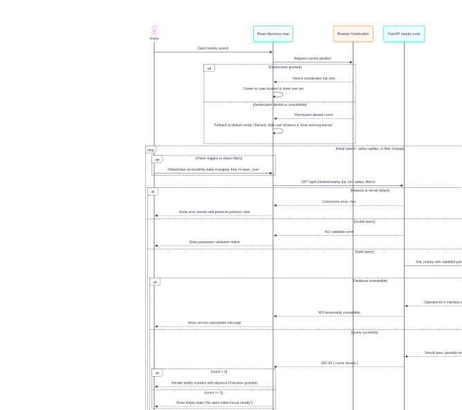

### Map and facility details · UC-09

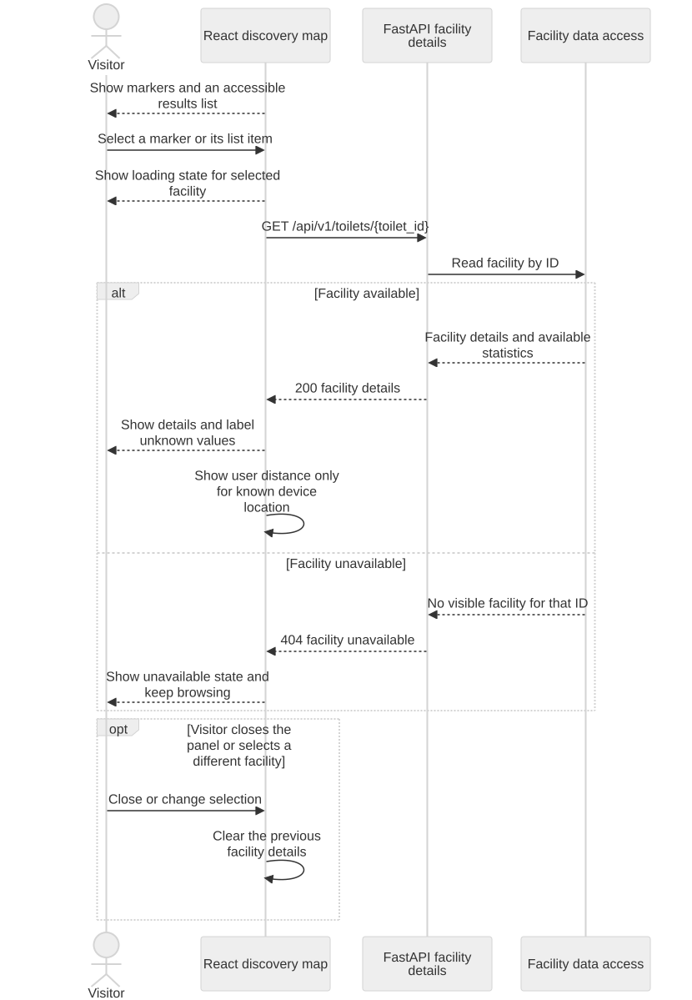

### Registration, sign-in and authorization · UC-08

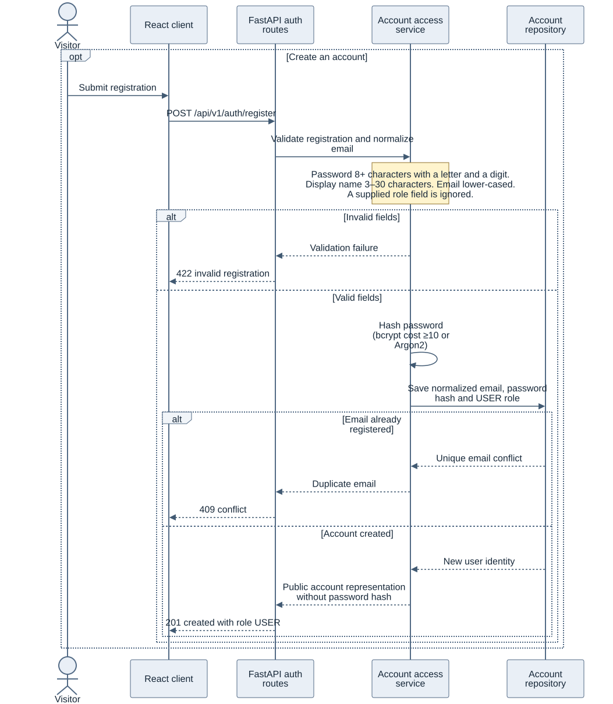

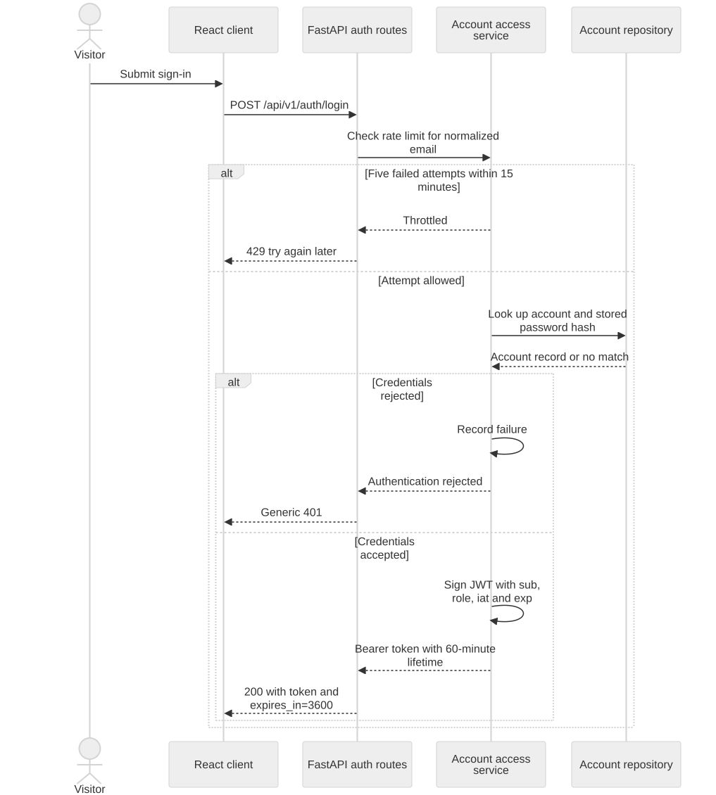

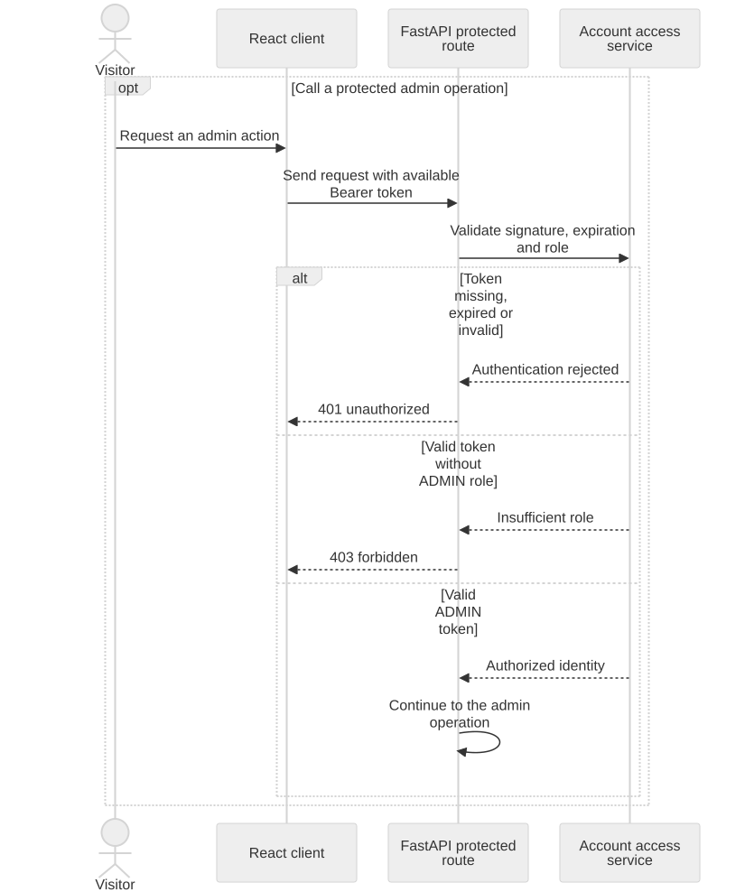

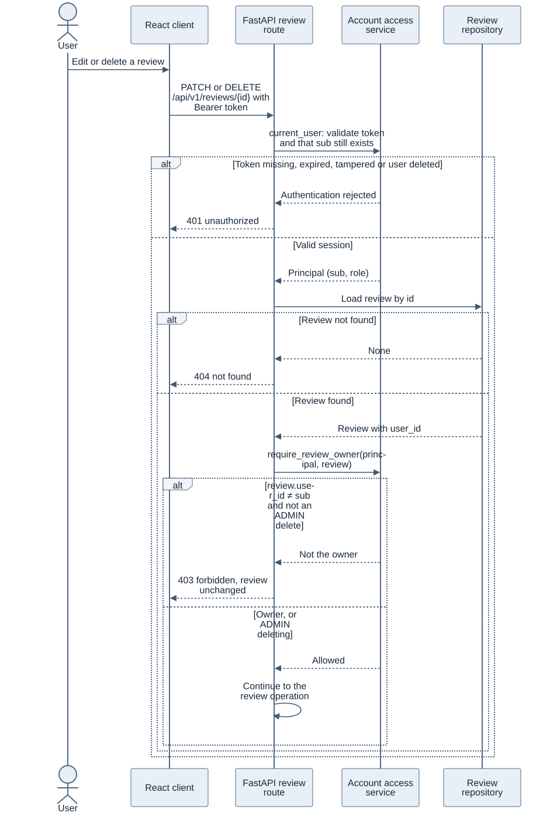

### Account deletion · UC-10

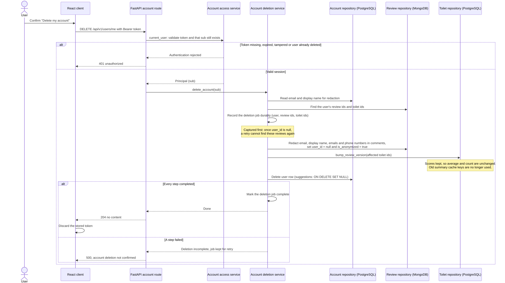

## 5. Non-functional design decisions

| Requirement | Design decision | Tool and evidence |
| --- | --- | --- |
| NFR-01 · Search latency | Use a PostGIS GiST index and `ST_DWithin` to limit candidates, then calculate and sort by distance. | Existing SQL checks and pytest/PostGIS integration verify correctness. Use PostgreSQL `EXPLAIN (ANALYZE, BUFFERS)` and a load run with 10,000 synthetic records and 50 clients to evaluate mean and p95 below 250 ms. Load measurement is pending. |
| NFR-02, NFR-07 · AI latency and availability | Cache summaries and enforce a 10-second fallback deadline. Keep AI out of the nearby-search request path. | Exercise cache hit, healthy provider and forced timeout with pytest and a controllable provider stub. Record p95 and repeat core browsing with the provider unavailable. Measurement is pending. |
| NFR-03, NFR-04, NFR-08 · Security and privacy | Enforce roles server-side. Hash passwords with bcrypt cost ≥10 or Argon2, issue signed 60-minute JWTs, and use HTTPS in deployment. Keep user coordinates out of persistent storage without consent. Redact PII before provider calls and during account deletion as required. | Use FastAPI validation and pytest for token, role and input boundaries. Capture requests with synthetic PII to verify redaction. Confirm HTTPS and secret handling in the deployment configuration. Auth and privacy verification are pending. |
| NFR-05, NFR-06 · Map usability and accessibility | Provide a keyboard-operable results list alongside map markers, labelled controls and visible focus. Use an explicit viewport center if geolocation is denied. | Use axe/Lighthouse and manual keyboard checks at 360, 768 and 1920 px. Run the 500-marker performance scenario. These checks are pending. |
| NFR-09 · Maintainability | Keep database and API tests executable in isolation. Run independent blocking checks for implemented features. | GitHub Actions and pytest cover the current search and database paths. The requirements baseline includes pending features. Backend coverage ≥80% remains a target. |

## 6. Review items and final deliverable

- Reconcile the review-store boundary and the consistency approach for aggregates, AI cache invalidation and account deletion.
- Review the admin API's distinction between empty results, dates with missing values and facilities with zero reviews.
- Confirm the map-to-live-API boundary and model the AI and administrative interactions with their contributors.
- Embed the reviewed diagrams in the final PDF and verify legibility and page fit. Generate it from the approved PR revision for Learn submission by 15 November.
