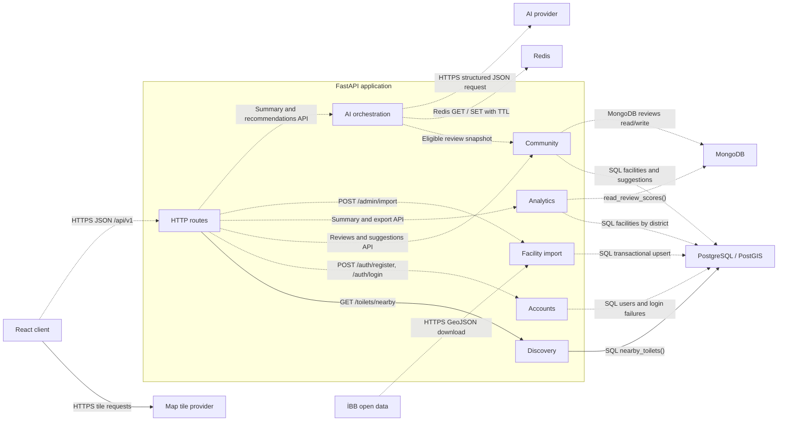

# SmartLoo component architecture

Solid arrows show interfaces available in the approved weekly integration snapshot or used by the map prototype. Dashed arrows show planned application connections. The route labels use the /api/v1 prefix.

[Back to the Software Design Report](../REPORT.md)
