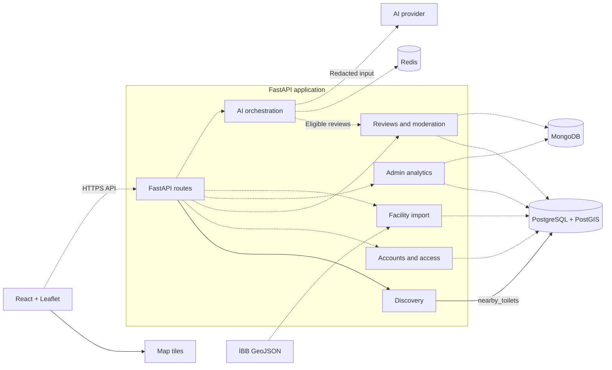

# SmartLoo component architecture

Solid edges identify the search implementation on the weekly branch and the map UI's public interface with its tile provider. Dotted edges show intended integration or planned services. The React/Leaflet discovery screen currently uses mock facility data in #37.

