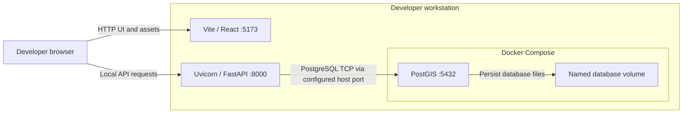
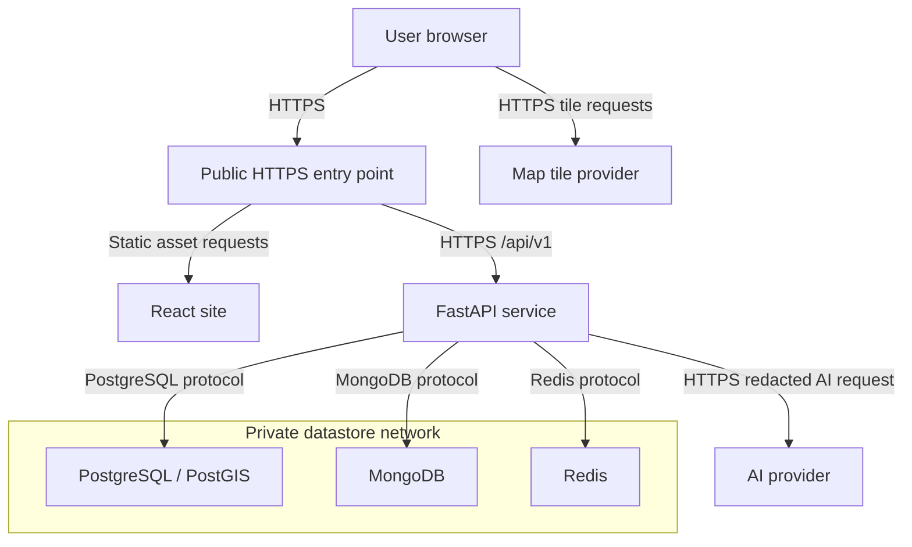

# SmartLoo deployment view

The current local setup runs Vite and Uvicorn on the developer host and PostGIS in Docker Compose. Ports 5173 and 8000 are dev defaults. PostGIS uses host port 5432 by default and a named volume. #54 proposes a Vite proxy for the map. The target layout shows boundaries and interfaces without assuming a cloud vendor.

## Current local setup

## Planned deployment

Only the web and API entry point is public in the target. Store credentials and provider keys at the service boundary. Actual hosting and deployment verification remain open.

[Back to the Software Design Report](../REPORT.md)
