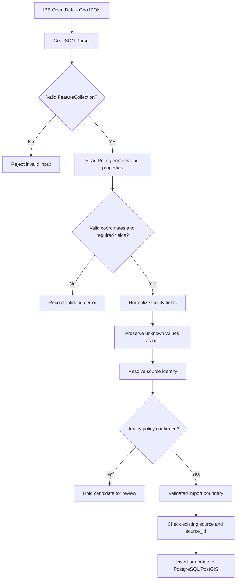

# IBB GeoJSON Adapter — Architecture Design

## 1. Purpose

The IBB GeoJSON adapter converts external public toilet
records into normalized SmartLoo facility candidates.

The adapter validates source data, preserves unknown
values, and separates external data processing from
database persistence.

This document describes the proposed architecture.
It does not claim that the adapter has been implemented.

## 2. Architecture Diagram

## 3. Source Field Mapping

| IBB source | SmartLoo target | Rule |
| --- | --- | --- |
| MAHAL_ADI | name | Required facility name |
| ILCE | district | Required district |
| GeoJSON coordinates[1] | latitude | Validate -90 to 90 |
| GeoJSON coordinates[0] | longitude | Validate -180 to 180 |
| TUVALET_DURUM | Source status metadata | Preserve original meaning |
| TUVALET_TIP | Source type metadata | Preserve source value |
| HIZMET_YERI | Source service metadata | Preserve source value |
| BAKIM_ODASI | Unconfirmed metadata | Do not assume baby-changing |
| Not provided | has_disabled_access | null |
| Not provided | is_free | null |
| Not provided | opening_hours | null |

Unknown values must not be interpreted as false.

Administrative ACTIVE status must not be interpreted
as evidence that the facility is currently open.

## 4. Coordinate Validation

GeoJSON Point coordinates follow:

[longitude, latitude]

SmartLoo API and database fields must use the
correct latitude and longitude values.

Features with missing, malformed, or out-of-range
coordinates must not be silently imported.

## 5. Source Identity

The inspected IBB facility GeoJSON does not expose
a verified stable facility identifier.

The verified dataset contains 422 point records,
but this does not establish 422 unique physical toilets.

A source-derived fingerprint may be considered as
an identity candidate using documented raw fields.

Collision handling, changes in source names or
coordinates, and identity versioning require team review.

Production upsert must not invent an ibb_source_id.

The existing (source, source_id) uniqueness rule
must be preserved after identity resolution.

## 6. Import Boundary

GeoJSON normalization is separate from the
administrator CSV/JSON import API.

The adapter prepares and validates candidates.
The import service is responsible for authorization,
record identity resolution, and persistence.

For an invalid administrative import batch,
the approved FR-07 contract requires atomic rejection
with row-level errors.

## 7. Implementation and Verification Status

This file specifies proposed behavior only.

A working adapter, repeat-import tests, real source
identity policy, and production PostGIS ingestion
must be verified separately.

Refs #14, #28, #39.

[Back to the Software Design Report](../REPORT.md)
