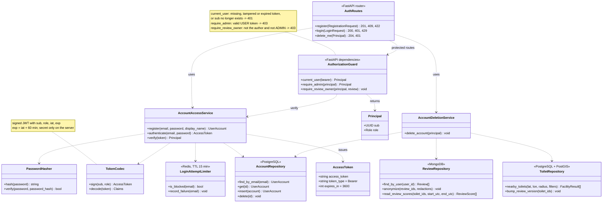

# Accounts, facilities, reviews and suggestions · class model

Owner: Fırat Karadoğan ([#38](https://github.com/akcedia/SmartLoo/issues/38)). Based on the approved [E-R model and data dictionary](../../analysis/data/er-data-dictionary.md) (#13), the PostGIS facility store in `db/` ([#24](https://github.com/akcedia/SmartLoo/issues/24), [#31](https://github.com/akcedia/SmartLoo/pull/31)) and [FR-08/FR-10](../../REQUIREMENTS.MD#38-fr-08--authentication-and-authorization).

**Status.** `Toilet` and `ToiletRepository.nearby_toilets()` are implemented on the weekly branch ([#36](https://github.com/akcedia/SmartLoo/pull/36)). #51 implements registration, sign-in and guards on its feature branch. Review, suggestion and account-deletion flows remain target design. The limiter shown below is the Redis target; #51 uses PostgreSQL for the current 15-minute window. `review_version` is the cache-invalidation proposal from [#28](https://github.com/akcedia/SmartLoo/issues/28#issuecomment-6400782736) and is not in the migrations yet.

## 1. Persistent data

Each class is one stored record. The stereotype names its store. Solid associations are SQL foreign keys inside PostgreSQL. Dashed associations are references from MongoDB documents to PostgreSQL rows; the application checks them because no database enforces them.

```mermaid
classDiagram
    direction TB
    class UserAccount {
        <<PostgreSQL users>>
        +UUID id
        +string email
        +string password_hash
        +string display_name
        +Role role
        +datetime created_at
    }
    class Role {
        <<enumeration>>
        USER
        ADMIN
    }
    class Toilet {
        <<PostgreSQL + PostGIS toilets>>
        +UUID id
        +string source
        +string source_id
        +string name
        +geography location
        +string district
        +bool has_disabled_access [0..1]
        +bool has_baby_changing [0..1]
        +bool is_free [0..1]
        +decimal price_try [0..1]
        +string opening_hours [0..1]
        +ToiletStatus status
        +decimal average_cleanliness [0..1]
        +int review_count
        +int review_version
    }
    class ToiletStatus {
        <<enumeration>>
        ACTIVE
        CLOSED
        MAINTENANCE
    }
    class Review {
        <<MongoDB reviews>>
        +UUID id
        +UUID toilet_id
        +UUID user_id [0..1]
        +int cleanliness_score
        +string comment [0..1]
        +string[] tags
        +bool is_anonymized
        +datetime created_at
        +datetime updated_at
    }
    class Suggestion {
        <<PostgreSQL suggestions>>
        +UUID id
        +UUID submitted_by [0..1]
        +UUID moderated_by [0..1]
        +UUID toilet_id [0..1]
        +string name
        +string district
        +decimal latitude
        +decimal longitude
        +SuggestionStatus status
        +datetime created_at
        +datetime decided_at [0..1]
    }
    class SuggestionStatus {
        <<enumeration>>
        PENDING
        APPROVED
        REJECTED
    }

    UserAccount --> "1" Role
    Toilet --> "1" ToiletStatus
    Suggestion --> "1" SuggestionStatus
    UserAccount "0..1" ..> "0..*" Review : authors
    Toilet "1" ..> "0..*" Review : receives
    UserAccount "0..1" -- "0..*" Suggestion : submits
    UserAccount "0..1" -- "0..*" Suggestion : moderates
    Suggestion "0..1" -- "0..1" Toilet : publishes

    note for UserAccount "email unique, stored lower-case<br>password_hash: bcrypt cost >= 10 or Argon2, never returned<br>public registration always gets role USER"
    note for Review "one review per (toilet_id, user_id) when user_id is set<br>after account deletion: user_id = null, is_anonymized = true"
    note for Toilet "(source, source_id) unique; NULL amenity = unknown<br>review_version: proposed, bumped with the aggregates"
```

| Rule | Where it is enforced |
| --- | --- |
| One account per e-mail, case-insensitive (409) | Unique index on the lower-cased `email` |
| One review per user and toilet (409, TC-32) | MongoDB partial unique index on `(toilet_id, user_id)` where `user_id` is not null; anonymous reviews are exempt |
| A review references an existing toilet (404, TC-33) | Review service checks `Toilet` before insert; the toilet must not be `CLOSED` |
| Reviewed toilets are never hard-deleted (TC-27) | `status = CLOSED` instead of `DELETE` |
| Suggestion keeps its facility data after account deletion | SQL `ON DELETE SET NULL` on `submitted_by` and `moderated_by` |
| Aggregates and cache stay consistent with reviews (REQ-DB-05) | `average_cleanliness`, `review_count` and `review_version` change in one PostgreSQL transaction |

## 2. Services and authorization boundary

The FastAPI implementation is function-based. Classes below model the planned modules and their interfaces; `AuthorizationGuard` methods become FastAPI dependencies.

**Interfaces requested for analytics ([#38 comment](https://github.com/akcedia/SmartLoo/issues/38), [#45](https://github.com/akcedia/SmartLoo/pull/45)).** Admin summary and export endpoints declare `Depends(require_admin)`; it returns the `Principal` or raises 401/403 as above. Analytics reads review scores through `read_review_scores(toilet_ids, start_utc, end_utc)`, start inclusive and end exclusive in UTC, returning `toilet_id`, `created_at` and `cleanliness_score` only, so no comment text or user identity reaches the dashboard. #51 provides the guard. #50 provides the reader with a MongoDB collection as its first argument; the analytics service still needs to supply that dependency.

[Back to the Software Design Report](../REPORT.md)
