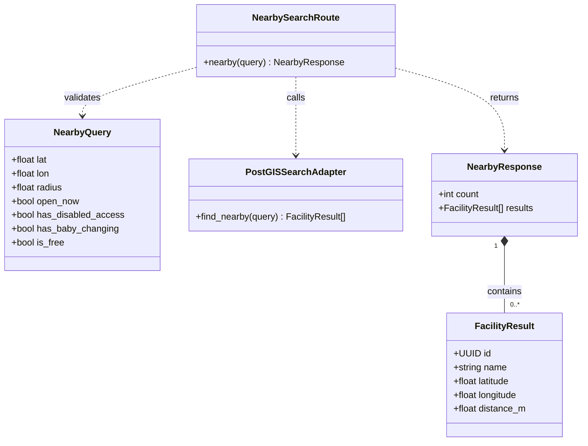

# Nearby-search class model

Logical class view of the route and adapter in [PR #36](https://github.com/akcedia/SmartLoo/pull/36). `NearbySearchRoute` and `PostGISSearchAdapter` represent the functions `nearby()` and `find_nearby()`. `NearbyQuery`, `NearbyResponse`, and `FacilityResult` are interface shapes. The implemented functions exchange validated arguments and row dictionaries.

The radius is in metres. Optional amenity filters accept true, false or omission. Unknown stored amenity values match neither true nor false. `FacilityResult` shows the fields required for map placement and distance ordering. Available amenity metadata travels with the result.

[Back to the Software Design Report](../REPORT.md)
