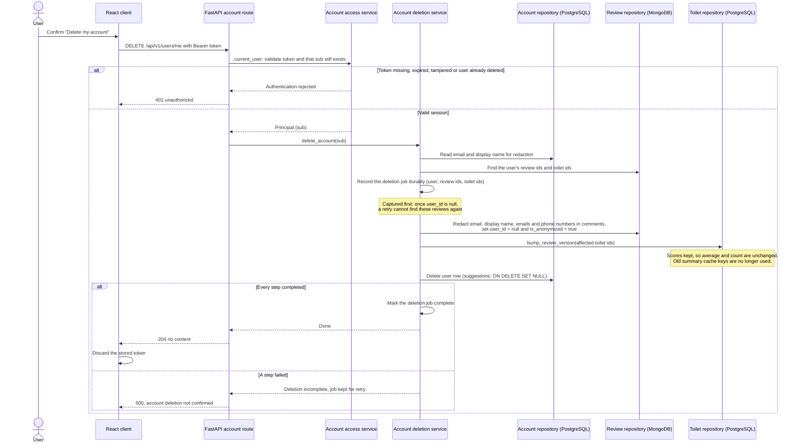

# Account deletion · UC-10 / FR-10

Owner: Fırat Karadoğan ([#38](https://github.com/akcedia/SmartLoo/issues/38)). Target model refined from the [account-deletion DFD](../../analysis/behavior/auth-account.md#4-account-deletion-fr-10-req-db-04-tc-34) (#13) and the [class model](../class/accounts-and-data.md). `DELETE /api/v1/users/me` still returns 501 on the weekly branch.

The account row and its personal fields are removed. Reviews are kept for statistics: their author link is cleared and personal data in the comment text is redacted, because clearing `user_id` alone is not enough (FR-10). Toilet averages do not change, since scores are retained (TC-34). Cached AI summaries of the affected toilets are made stale by bumping `review_version` ([#28 proposal](https://github.com/akcedia/SmartLoo/issues/28#issuecomment-6400782736)).

Later requests with the old token reach `current_user`, find no account for `sub` and get 401, so the 60-minute token stops working immediately.

**Open design decisions.** How the recorded job is retried and how concurrent review creation or summary generation is kept from reintroducing the user's data are not decided yet. Automatic redaction covers known patterns only; remaining personal details in free text are handled by ADMIN moderation (REQ-SEC-05). Whether deletion requires re-entering the password is not in the requirements and is left for team decision.
