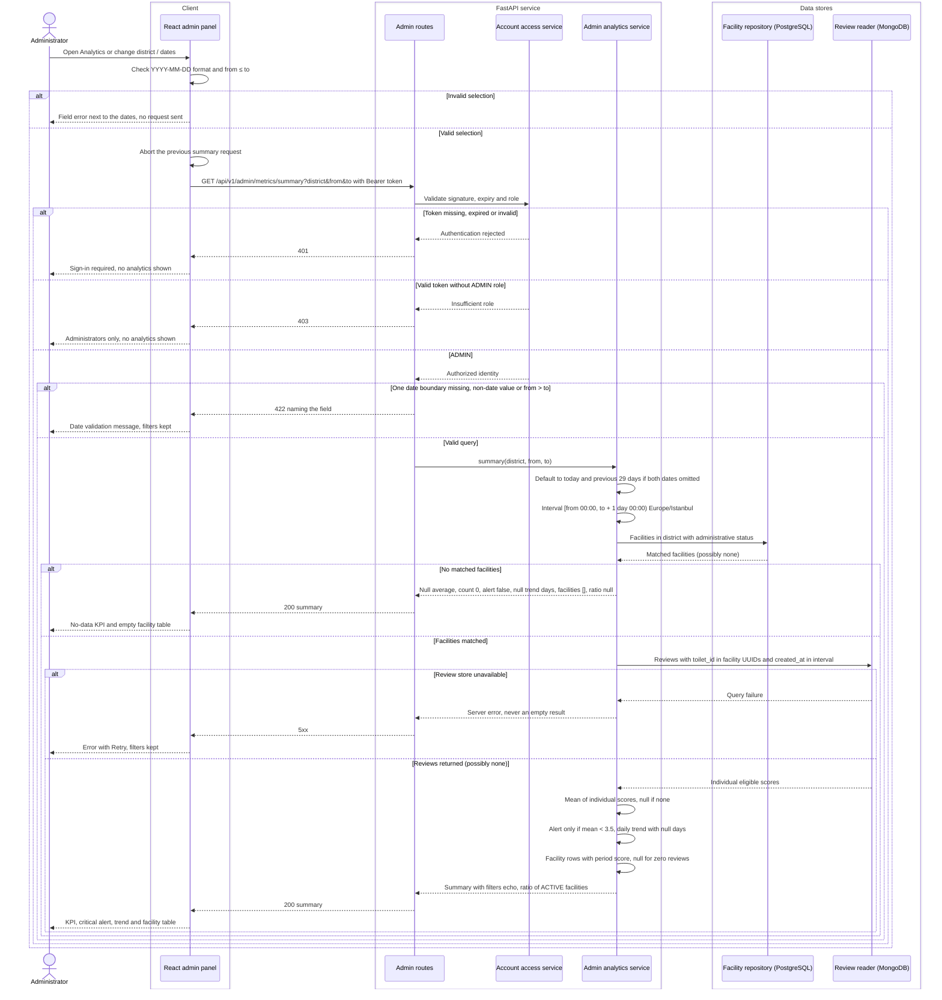
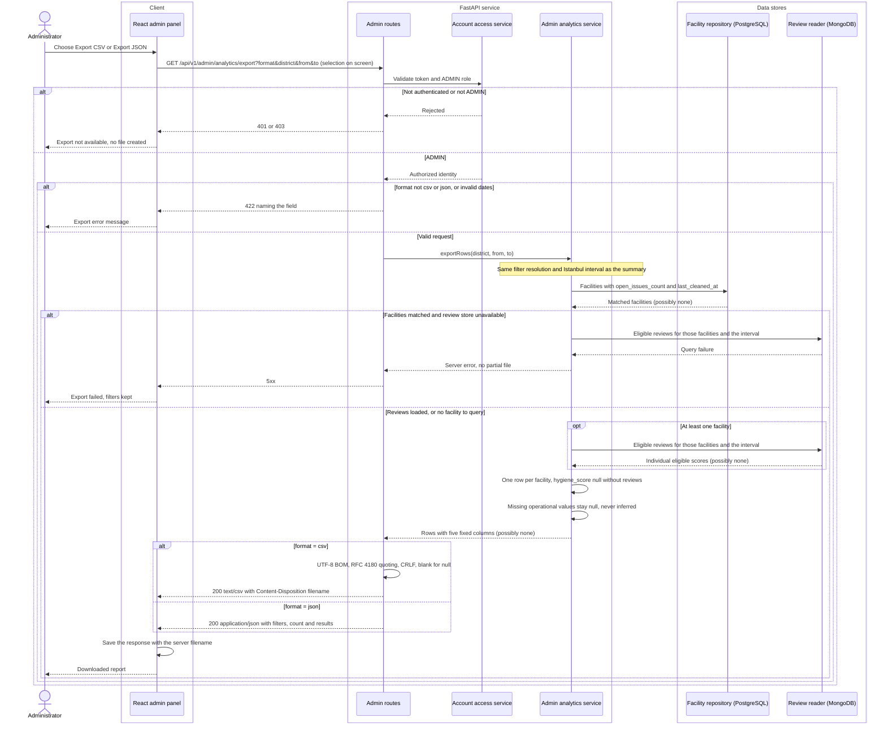

# Administrator analytics and report export · UC-06 and UC-07

Target model for FR-06 and the export part of FR-07, based on the [admin analytics API contract](https://github.com/akcedia/SmartLoo/blob/d404deb4/docs/contracts/admin-analytics-api.md) revised in #45. Contributor: Onur Arda Buldağ (#40). CSV/JSON facility import is outside these diagrams; its adapter boundary is modelled with #39.

Both diagrams use the same three boundaries:

| Boundary | Responsibility |
| --- | --- |
| React admin panel | Holds the district/date selection, validates date format and order, cancels obsolete requests and renders KPI, trend, table, export and error states. The same selection is sent to summary and export. |
| FastAPI admin routes and analytics service | Enforce ADMIN authorization server-side, validate the query, resolve default dates and the Europe/Istanbul interval, and compute every view from one set of eligible reviews. |
| Data queries | PostgreSQL supplies facilities, district and administrative status. MongoDB supplies individual reviews selected by facility UUID and `created_at`. The stored all-time facility aggregate is not used, because it cannot be date-filtered. |

## Filtered hygiene analytics · UC-06 / FR-06

## CSV and JSON report export · UC-07 / FR-07

An empty facility selection still returns 200: a CSV containing only the header row, or JSON with `count: 0` and `results: []`.

## Contract decision: empty results, null days and facilities without reviews

The open question from the first contract is decided as follows (contract §2.3, §3 and §5, reviewed in #45):

| Situation | Summary | Export |
| --- | --- | --- |
| Facilities matched, no reviews in the period | `average_cleanliness: null`, `review_count: 0`, `critical_alert: false`. Every selected day appears in `trend` with a null average and count 0. Every matched facility stays in `facilities` with `hygiene_score: null`. The ACTIVE ratio stays available. | One row per facility with a blank (CSV) or null (JSON) `hygiene_score`. |
| No matched facilities (including an unknown district) | Same null KPI and daily trend, `facilities: []`, `active_facility_ratio: null`. Still 200, not 404. | Header-only CSV; JSON `count: 0`, `results: []`. |
| Some days without reviews | Those trend rows have a null average and count 0; the chart leaves a gap and never plots 0. | Not applicable. Export is one row per facility. |
| Review store unavailable | Server error. An empty result is reserved for a successful query, so the panel shows Retry rather than “No data”. | Server error; no partial file. |

## Implementation status

| Part | Status |
| --- | --- |
| React admin panel with the states above | Implemented with a labelled sample adapter in #45 (`weekly-review-2026-10-24` base). 38 frontend tests pass, including both empty cases; verified in the browser for this report. |
| HTTP adapter for both endpoints | Written in the panel but not connected. |
| `GET /api/v1/admin/metrics/summary`, `GET /api/v1/admin/analytics/export` | Return 501. Depend on server-side ADMIN authorization (#38) and a MongoDB review reader. |
| Account access service, review reader | Target components; not yet implemented. |
