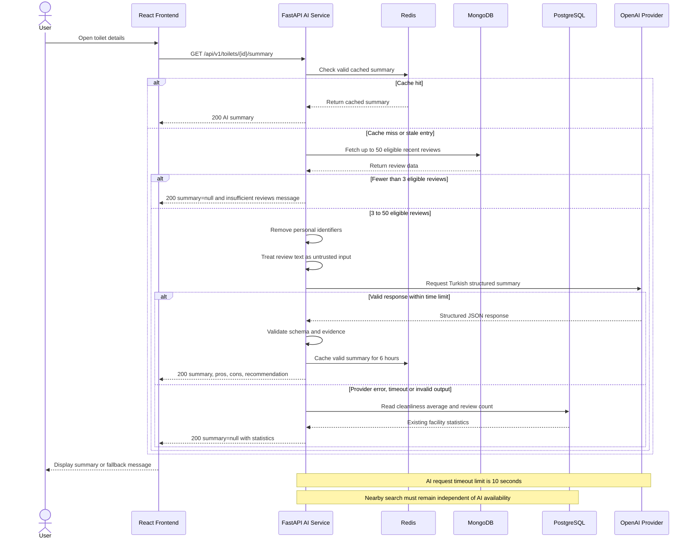

# AI Review Summarization Sequence — UC-04 / FR-04

## Purpose

This sequence diagram describes the proposed AI-powered review summarization workflow in SmartLoo.

The design includes Redis caching, MongoDB review retrieval, personal data sanitization, structured AI output validation, and graceful fallback behavior.

This is a target design, not evidence of a completed production integration.

## Sequence Diagram

## Design Constraints

- AI summaries require at least 3 eligible reviews.
- At most 50 recent eligible reviews are used as input.
- Personally identifiable information must be removed before external AI calls.
- AI-generated summaries must be written in Turkish and limited to 400 characters.
- Output must follow the approved structured JSON contract.
- Valid summaries may be cached in Redis for 6 hours.
- Review changes must prevent stale summaries from being served.
- AI provider failures, invalid responses, or 10-second timeouts must trigger a fallback.
- The fallback returns `summary=null` with existing cleanliness statistics.
- Nearby toilet search must not depend on AI service availability.

## Integration Status

This diagram specifies the intended workflow. Live OpenAI integration, review-store coordination, cache invalidation implementation, and end-to-end verification are separate implementation tasks.

Refs #14, #28, #39 and #46.

