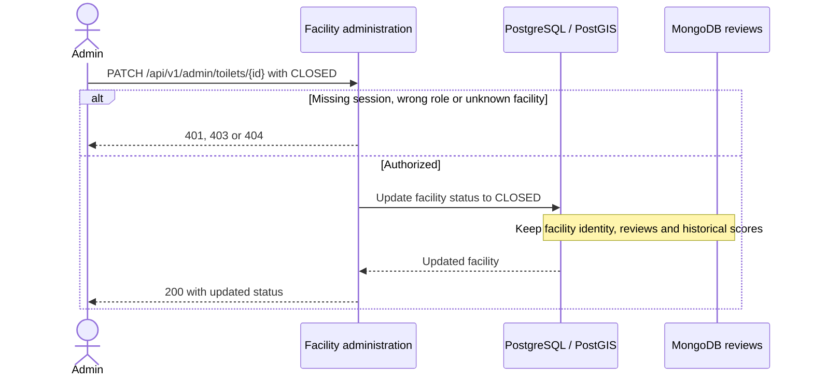

# Facility closure and retained reviews · UC-10 / FR-10

The second UC-10 element protects historical reviews and keeps the facility identity stable.

[Back to the Software Design Report](../REPORT.md)
