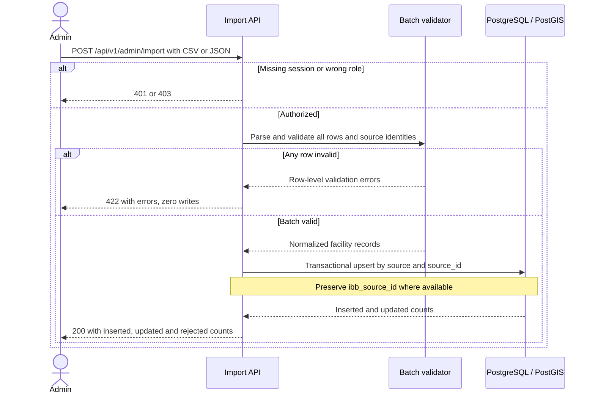

# Administrator facility import · UC-07 / FR-07

The admin batch import is separate from the normalization of raw İBB GeoJSON. A stable source identity is a prerequisite for production ingestion.

[Back to the Software Design Report](../REPORT.md)
