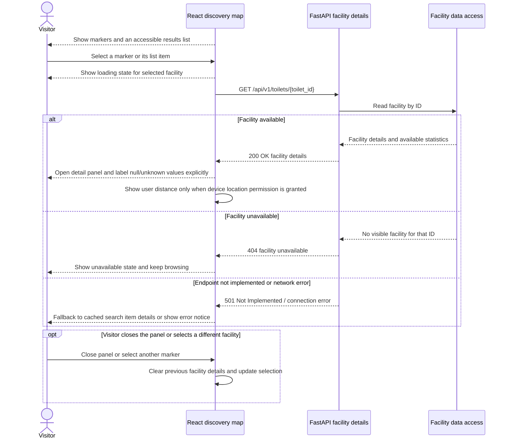

# Map and facility details · UC-09

`#37` implements a local detail panel backed by the selected facility object from the mock search dataset. The sequence below describes the target integration with the dedicated facility detail endpoint (`GET /api/v1/toilets/{toilet_id}`), which is currently a `501` placeholder route on the weekly branch (`#36`).

[Back to the Software Design Report](../REPORT.md)
