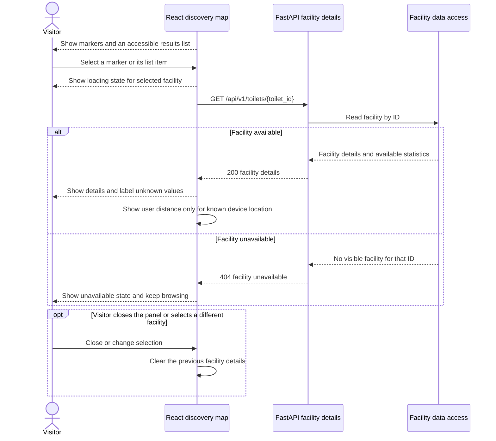

# Map and facility details · UC-09

#37 shows a local detail card backed by mock data. The sequence describes the target connection to the selected facility detail endpoint, currently a 501 route on the weekly branch.

