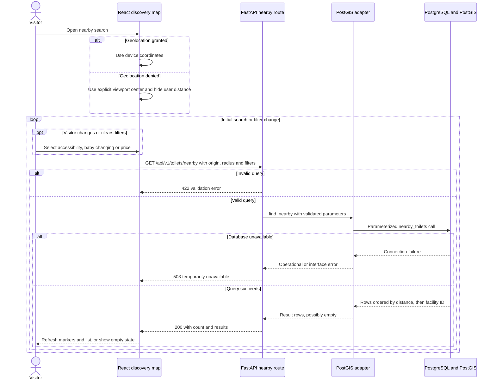

# Nearby search and filtering · UC-01 and UC-02

The API and database interactions are implemented on the weekly branch. The React-to-API connection shown here is the target integration for the current mock map.

For UC-01, the client requests `open_now=true` when showing nearby open facilities. Clearing an amenity filter omits that parameter. The implementation accepts radius 1–50,000 m and returns 200 for zero matches. Refs #25, #26 and #35.
