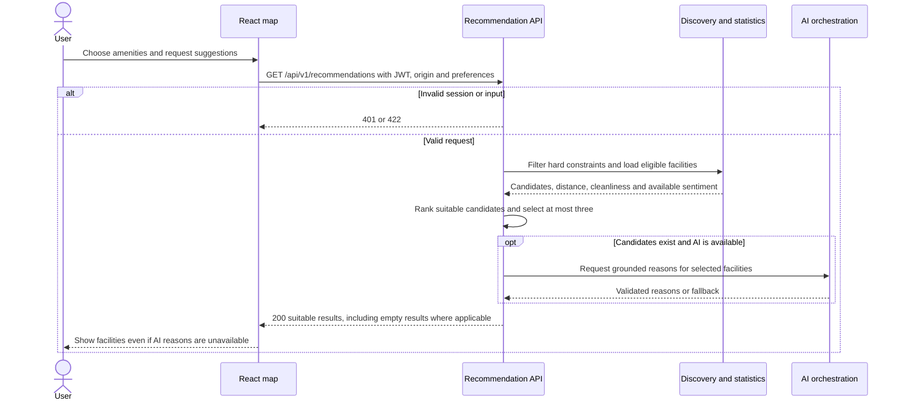

# Preference recommendations · UC-04 / FR-04

This is the second interaction in UC-04. The recommendation path ranks suitable facilities from request preferences.

[Back to the Software Design Report](../REPORT.md)
