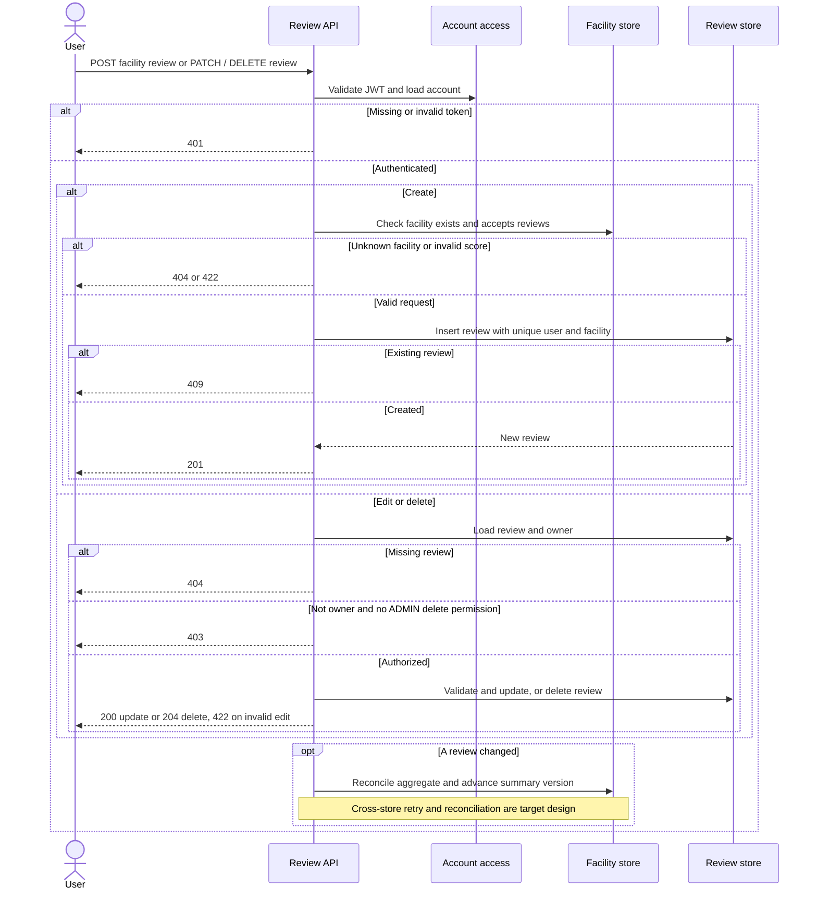

# Review lifecycle · UC-03 / FR-03

Target design. The review store enforces one active author/facility pair. Change events coordinate aggregates and summary cache across stores.

[Back to the Software Design Report](../REPORT.md)
