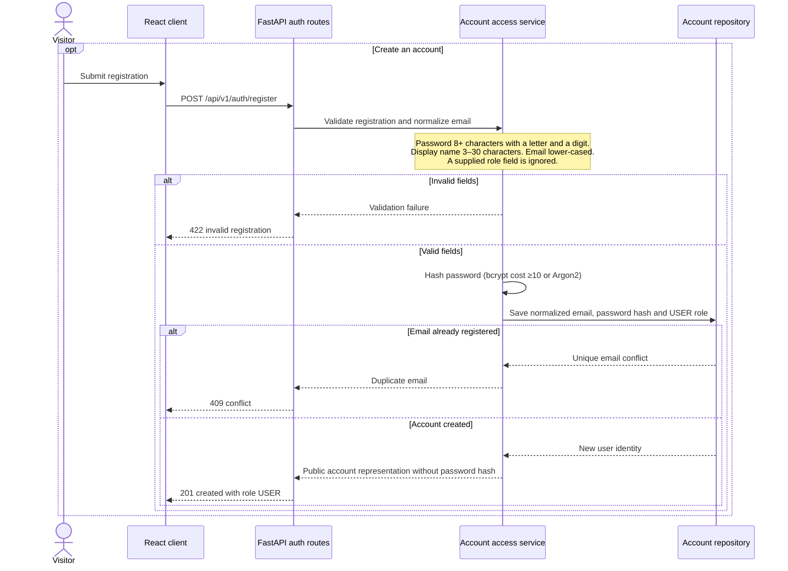
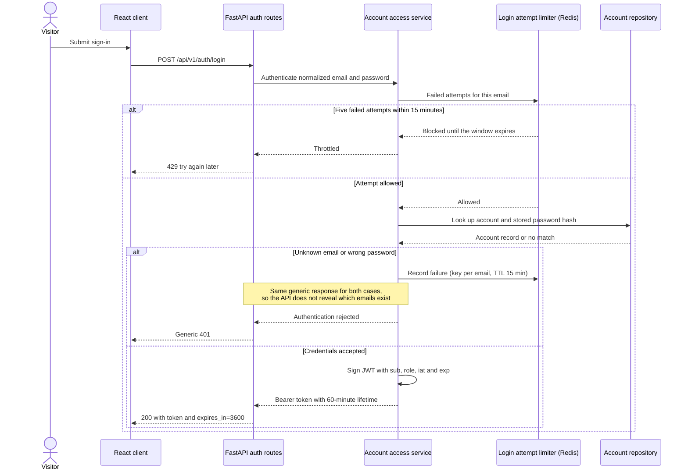
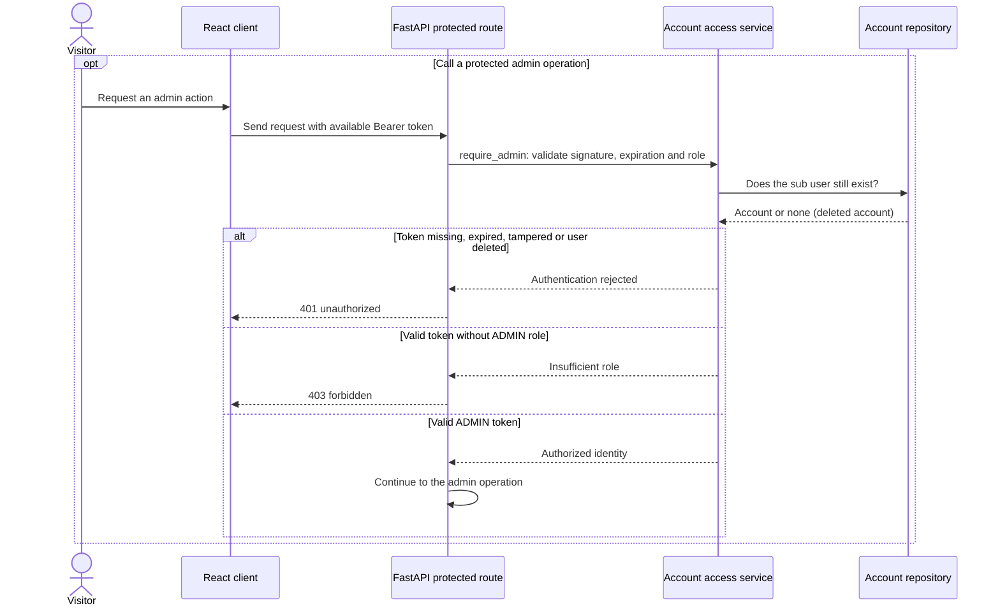
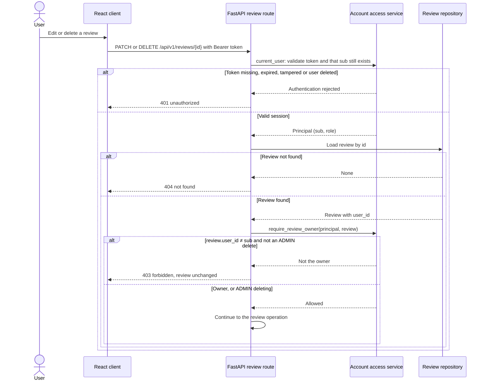

# Registration and sign-in · UC-08

Target model based on FR-08 and the approved security requirements. Account access routes are placeholders on the weekly branch.

The diagram above guards administrator routes. The next one shows the same 401/403 split for an ordinary signed-in user: editing or deleting a review is allowed only for its author, and an ADMIN may delete any review (REQ-SEC-05). It covers only the authorization step of UC-03; review persistence and aggregates belong to the review model.

