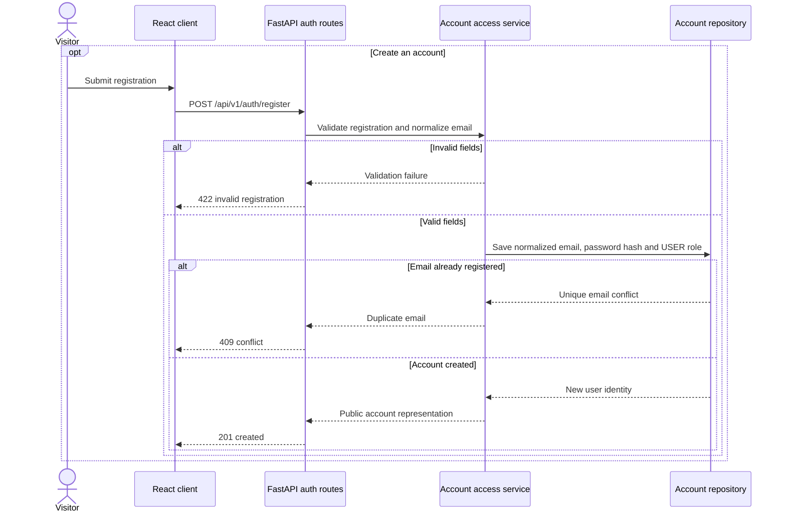
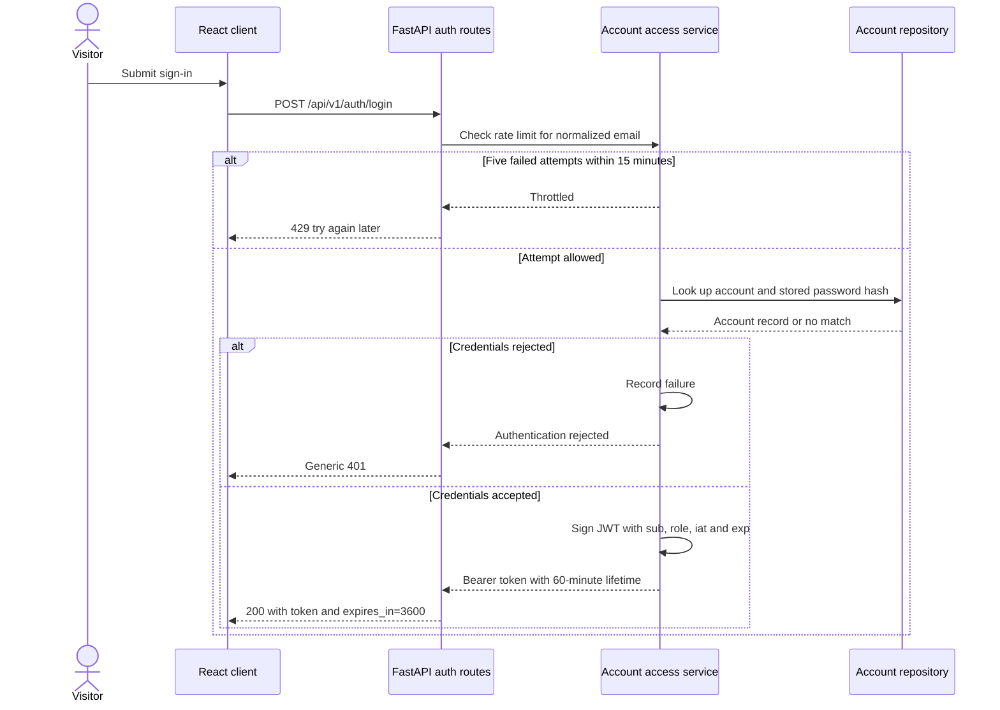
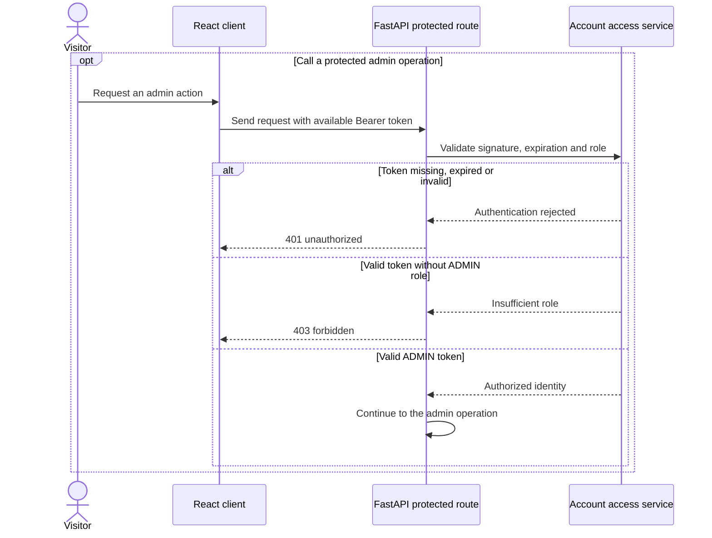

# Registration and sign-in · UC-08

Target model based on FR-08 and the approved security requirements. Account access routes are placeholders on the weekly branch.

[Back to the Software Design Report](../REPORT.md)
