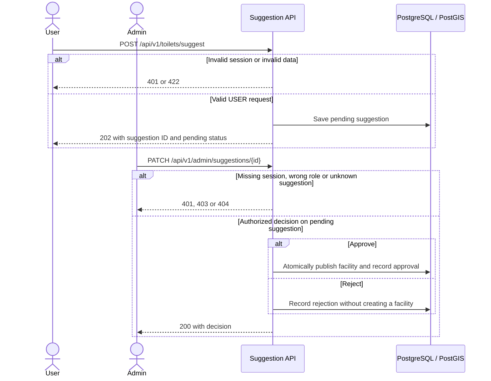

# Facility suggestion and moderation · UC-05 / FR-05

The two approved UC-05 elements share this target model. Pending and rejected suggestions are hidden from the public map.

[Back to the Software Design Report](../REPORT.md)
